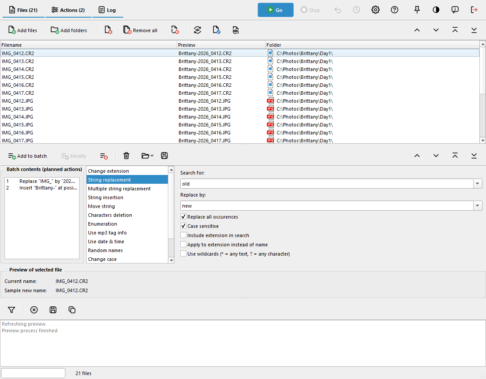

# Ant Renamer Qt


C++/Qt 6 port of [Ant Renamer](https://www.antp.be/software/renamer/) 2.13 (originally Delphi 7,
GPL v2 or later). Batch file renaming: replace, insert, move, delete, enumerate, change case, regular
expressions, names from a list, file date, MP3 tags (ID3v1/v2), EXIF / IPTC / XMP.

**Ant Renamer Qt** is the official name of this port, agreed with the author of the original program. It is
developed in parallel with the original Ant Renamer and has its own executable, installation folder, settings and
package names, so both can be installed side by side without confusion.



More screenshots (classic and modern interface, light and dark theme, help, About) are in [docs/screenshots/English](docs/screenshots/English).

## Download

Windows installer and portable zip, Linux `.deb` (x86_64, arm64) and AppImage: [Releases](https://github.com/morfredus/ant-renamer-qt/releases).

**Checking the Linux files.** The Linux files of the releases after 3.0.0 come with a detached GPG signature (`.asc`), also for `SHA256SUMS-linux.txt`. Public key: [`docs/antrenamer-qt-public.asc`](docs/antrenamer-qt-public.asc), fingerprint `D82C 3ED0 BE99 1611 C2C9 06FA 910B 46ED 3C84 B4A7` (Frederic Biron, Ant Renamer Qt releases). Compare the fingerprint before trusting the key.

```
gpg --import antrenamer-qt-public.asc
gpg --verify AntRenamerQt-X.Y.Z-linux-amd64.deb.asc AntRenamerQt-X.Y.Z-linux-amd64.deb
```

The Windows files are not signed yet (checksums are in `SHA256SUMS.txt`).

The project is **self-contained**: Qt 6 and a C++20 compiler are the only requirements.

## Build

```bash
cmake --preset mingw   && cmake --build --preset mingw     # Windows (MSYS2 / MinGW-w64)
cmake --preset linux   && cmake --build --preset linux     # Linux x86_64
cmake --preset linux-arm64 && cmake --build --preset linux-arm64   # ARM64 machine (e.g. Raspberry Pi)
ctest --preset linux                                       # tests
```

Output: `build-mingw/app/antrenamer-qt.exe` (Qt and MinGW DLLs are deployed next to it) or
`build/app/antrenamer-qt`. `linux-arm64-cross` cross-compiles from x86_64: set `ARM64_SYSROOT` to an
ARM64 sysroot containing Qt 6 (see `cmake/toolchains/linux-aarch64.cmake`).

Release (Windows): `powershell -ExecutionPolicy Bypass -File scripts\windows\package-win.ps1` writes
`dist/AntRenamerQt-<version>-win64-portable.zip` and, if Inno Setup 6 is installed, the `-setup.exe` installer.

Linux packages (on Linux or in WSL): `scripts/linux/package-deb.sh` builds `dist/AntRenamerQt-<version>-linux-<arch>.deb` and
`scripts/linux/package-appimage.sh` the x86_64 AppImage, after `cmake --preset linux && cmake --build --preset linux`.
On aarch64 use the `linux-arm64` preset; from x86_64, `linux-arm64-cross` builds the arm64 package with an arm64 sysroot
(`ARM64_SYSROOT`), then `package-deb.sh --build build-arm64-cross`.

Windows prerequisites: MSYS2 with `mingw-w64-x86_64-{gcc,cmake,ninja,qt6-base,qt6-tools}`.

## Layout

| Folder | Content |
|---|---|
| `core/` | renaming engine, QtCore only |
| `app/` | Qt Widgets interface, `Languages/` and `help/` from the original program |
| `tests/` | engine checks and actions editor checks (`ctest`) |
| `cmake/toolchains/` | ARM64 cross toolchain |
| `scripts/windows/` | MinGW DLL deployment, VS Code helper, zip and installer |
| `scripts/linux/` | `.deb`, AppImage, `.desktop` file |
| `installer/` | Inno Setup script (Windows installer) |
| `docs/` | guides, presentation, release notes |
| `.github/` | CI workflow, Dependabot, issue templates |

## About this port

What was kept, changed and added compared with Ant Renamer 2.13:
[docs/PRESENTATION.md](docs/PRESENTATION.md) ([fr](docs/PRESENTATION_fr.md)).

## User guide

Every function with instructions (actions, shortcuts, masks, tags, command line, options, icon sets, differences between Windows and Linux):
[docs/USER_GUIDE.md](docs/USER_GUIDE.md) ([fr](docs/USER_GUIDE_fr.md)).
Step-by-step recipes for common and complex cases (cleaning names, numbering, photos, music, moving files, command line):
[docs/USER_RECIPES.md](docs/USER_RECIPES.md) ([fr](docs/USER_RECIPES_fr.md)).

## Development

Building, testing and packaging: [docs/BUILDING.md](docs/BUILDING.md) ([fr](docs/BUILDING_fr.md)).
Systems the program has really been tested on: [docs/TESTED_PLATFORMS.md](docs/TESTED_PLATFORMS.md) ([fr](docs/TESTED_PLATFORMS_fr.md)).
How the code is organised and how a renaming runs: [docs/ARCHITECTURE.md](docs/ARCHITECTURE.md) ([fr](docs/ARCHITECTURE_fr.md)).
Contributing: [CONTRIBUTING.md](CONTRIBUTING.md) ([fr](CONTRIBUTING_fr.md)). Code of conduct: [CODE_OF_CONDUCT.md](CODE_OF_CONDUCT.md) ([fr](CODE_OF_CONDUCT_fr.md)). Reporting a security problem: [SECURITY.md](SECURITY.md) ([fr](SECURITY_fr.md)).
Translating the interface (the `.lng` files): [docs/TRANSLATING.md](docs/TRANSLATING.md) ([fr](docs/TRANSLATING_fr.md)).

## Settings

Portable mode: create an empty `antrenamer-qt.ini` next to the program (or tick the box in
Options > Display). Otherwise settings live in `%APPDATA%\AntRenamerQt\Ant Renamer Qt\antrenamer-qt.ini` (Windows) or `~/.local/share/AntRenamerQt/Ant Renamer Qt/antrenamer-qt.ini` (Linux).

Explorer context menu (Windows): Options > Files & Folders adds "Add to Ant Renamer Qt" to files and folders (Windows 11:
"Show more options"). Everything selected is sent to the window that is already open.

Command line: `-b file.arb` load a batch, `-g` start, `-x` exit when done, `-a[fFr]` choose what the
following paths add (f files, F folders, r recursive; wildcards allowed).

## Privacy

The program does not use the network, except for the new-version check, which is **off by default** (Options > Display): when you turn it on, it asks `api.github.com` once a day for the list of releases of this project, and nothing else is sent. If GitHub cannot be reached, nothing happens and the program works as usual.

## Support

Support for Ant Renamer Qt is provided on GitHub: [Issues](https://github.com/morfredus/ant-renamer-qt/issues) (bugs, feature requests) and [Discussions](https://github.com/morfredus/ant-renamer-qt/discussions) (questions, ideas). Please do not report Ant Renamer Qt problems to the author of the original program.

## Support the port

Ant Renamer Qt is free software and stays so: nothing is reserved to those who give. If you want to support the work on the Qt port (not the original program, which is by Antoine Potten), use the "Sponsor" button of the repository ([GitHub Sponsors](https://github.com/sponsors/morfredus) or [PayPal](https://www.paypal.com/donate/?hosted_button_id=X4FPQCL7BL2FG)). To support the original program, its author has his own [donation page](https://www.paypal.com/donate/?cmd=_s-xclick&hosted_button_id=7LPTSBU87XB34).

## Credits

- Original program: Antoine Potten, [Ant Renamer](https://www.antp.be/software/renamer/) (Delphi 7, GPL v2 or later).
- C++/Qt 6 port and Linux port: Frédéric Biron ([morfredus](https://github.com/morfredus)).

## License

GPL v2 or later, like the original program.
