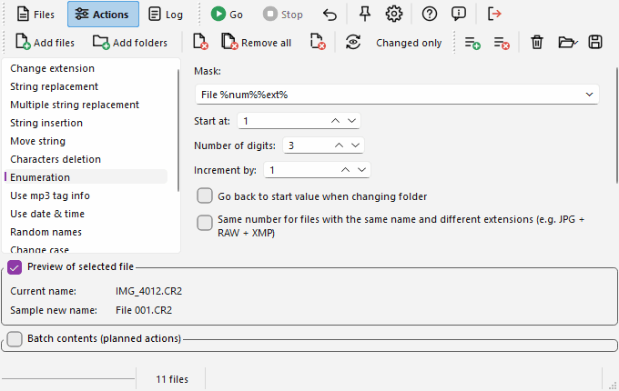

# Actions page

This page displays the actions that can be applied to the files. Choose an action in the list on the left, set its parameters on the right, then click  "Add" (Ctrl+F2) to put it in the [batch](batch_en.md). Several actions can be stacked: they are applied one after the other, in the order of the batch. The batch can also be empty: in that case the action currently displayed is the one that is applied (and previewed).

- [Change extension](#changeext)
- [String replacement](#stringrepl)
- [Multiple string replacement](#multstrrepl)
- [String insertion](#stringinsert)
- [Move string](#movestring)
- [Characters deletion](#chardel)
- [Enumeration](#enum)
- [Use mp3 tag info](#mp3)
- [Use date & time](#datetime)
- [Random names](#random)
- [Change case](#case)
- [Take names from list](#fromlist)
- [Regular expression](#regexp)
- [Use EXIF info](#exif)

This page has also commands to manage batch files. In addition to the Files toolbar which is always visible, a toolbar to manage these batch files is displayed. For more information about batches, see [this page](batch_en.md).

At the bottom of the window, there are two panels:

- **Preview of selected file**, which displays the current and future name of the selected file of the Files list (or first file if none is selected). This preview is refreshed at each change in actions parameters, allowing you to directly see the results of what you change in these parameters.
- **Batch contents** (hidden by default), which displays the planned actions. It is described on the ["Batch"](batch_en.md) page.

You can hide/show these panels using the checkbox at the left of their title.

Under the parameters of most actions, a *Notes* area recalls the available tags. Its "see Help" link opens the [Formatting](format_en.md) page (or the page about regular expressions or about metadata tags), and the names of other actions in the notes are links that switch to that action.

**Files and folders.** Folders can be renamed too. By default a folder name is treated like a file name without extension, so an action that works on the extension does nothing on a folder. The option "Consider the last "." in a folder name as extension delimiter" in the [Options](options_en.md#processing) changes that.

## Change extension {#changeext}

You can override the extension by a new one, or append the new one after existing one if you check the option "Do not replace extension, append it to current full name".

The dot will be added in front of your extension: do not type it. To remove current extension, simply leave the field empty. If you want an extension that changes from one file to the next (".001", ".002"...), use the [Enumeration](#enum) action.

## String replacement {#stringrepl}

You can replace a text by another in the filenames. The options are:

- **Replace all occurences** (on by default): if it is not checked, only the first occurence of the text in each filename will be replaced.
- **Case sensitive** (on by default).
- **Include extension in search**: the search is done in the whole name, extension included. By default only the name without extension is processed.
- **Apply to extension instead of name**: only the extension (without its dot) is processed.
- **Use wildcards** (off by default): see below.

This action can be also used for inserting a string before or after an existing one (if you do not know the position where the new string has to be placed). For example, if you want to insert "2" after all the "test" contained in names, replace "test" by "test2".

It can also be used for deleting a specified string: simply leave the second field empty for that.

With the "Use wildcards" option, `*` in the search field stands for any text (even empty) and `?` for any single character; all the other characters are searched as they are. The text found is as short as possible: `a*b` in "a1b2b" finds "a1b". For example, searching "IMG\_\*\_copy" and replacing by "Photo" turns "IMG_001_copy (1).jpg" into "Photo (1).jpg". The replacement text is always taken literally. For more complex patterns, use a [regular expression](#regexp).

## Multiple string replacement {#multstrrepl}

You can enter here multiple strings to replace. The left column contain the strings to search in names, the right column contains the text to put instead (which can be an empty string). The replacements are done line after line, from the top to the bottom of the table. The options **Include extension in search** (off by default) and **Case sensitive** (on by default) apply to the whole table.

It can be used for single characters replacement, like replacing all accentuated characters by their latin equivalent (a set called "Remove west-european accents" is provided), or to replace whole strings, of different lengths.

You can save the table contents to retrieve it later from the "Predefined sets" drop-down list. Type a name in this field and click "Save"; "Delete" removes the set whose name is displayed and "Clear Table" empties the table.

To add a line in the table, press "Ctrl" and "Plus" (+) keys. The new line will be added before the selected cell. In the same way, pressing "Ctrl" and "Minus" (-) keys will remove current line.

The "Copy/Export" and "Paste/Import" buttons allow you to easily export and import the contents of the whole table as plain text to modify it in Excel or any text editor. Each row of the table corresponds to a line of text, and the two columns are separated by a tab character (this is what Excel uses as column separator for copy/paste).

## String insertion {#stringinsert}

You can insert a string at any position, counting from begin or end of the name. Zero means that the string will be inserted before the first existing character or after the last one.

The extension is not included when counting characters, so an option to apply this to extension instead of name is provided.

This action supports the following tags:

- `%name%` : Put the original name of the file, without extension
- `%ext%` : Put the original extension of the file, including the dot
- `%folderN%` : Put the N-th parent folder
- `%%` : A "%" character

See the [chapter dedicated to the folder tag on the "Formatting" page](format_en.md#folder) for more information. A "\\" in the inserted string makes the file move to a folder, see the ["Force directories" option](options_en.md#processing).

## Move string {#movestring}

You can move a predefined number of characters from a place to another of the name. Like for [string insertion](#stringinsert), the "From" and "To" position start at 0 (where 0 = before first character or after last one), counting from the beginning or from the end of the name.

The "To" position counts the characters in the remaining ones. It means that first the specified number of characters are deleted, then the program will try to insert them again.

For example, in "abcdef" string, if you move 1 character from position 2 (the "c") to position 4, it will not appear after the "d" but after the "e": since the "c" has been removed, the "d" becomes the third character and the "e" the fourth.

## Characters deletion {#chardel}

You can specify here a number of characters to cut. Three ways to choose where:

- **From position**: from the given position, counting from the beginning or from the end of the name (like for [string insertion](#stringinsert));
- **After the string**: the characters that follow the first occurence of the given string;
- **Before the string**: the characters that precede the first occurence of the given string.

If the string is not found, nothing is deleted. The option "Apply to extension instead of name" works on the extension.

## Enumeration {#enum}

For this action, you have to specify a mask. This mask has to contain at least the %num% tag, to indicate to the program where to put the number that it will generate.

- `%name%` : Put the original name of the file, without extension
- `%ext%` : Put the original extension of the file, including the dot
- `%num%` : Put the current number
- `%folderN%` : Put the N-th parent folder

For example, if you want to call your images "File 0001.jpg", "File 0002.jpg", etc. you can enter `File %num%%ext%`. You can put ".jpg" instead of "%ext%" if you do not want to keep original extension (or if all are the files are JPEG).

See the ["Formatting"](format_en.md) page for more information about masks and tags.

"Start at" is the number to give to the first file (it can be negative). "Number of digits" represent the minimum number of digits to write (if the current number as less digits, zeroes will be added in front of it; put this field at 1 if you do not want to insert zeroes in front of numbers). "Increment" is the amount added for each file (it can be negative). The numbers follow the order of the Files list: sort the list first if you want another order.

If the files are grouped by folders (i.e. the primary sort is the folder name, so the folders' contents are not mixed in the list) you can use the option "Go back to start value...". It will restart at the "Start at" value when the current file is in another folder than the previous one. This allows to make same kind of enumeration in lots of folders without having to do the operation for each folder separately.

The option "Same number for files with the same name..." gives the same number to files of one folder that have the same name (without extension) but different extensions, for example `IMG_1234.JPG` and `IMG_1234.CR2` from a camera. A file whose extension is already in the group gets a new number. The files must follow each other in the list (sort by name).

## Use mp3 tag info {#mp3}

Here again you have to enter a mask. The tags are read from the ID3 information of the file: ID3v2 (2.2, 2.3 and 2.4) at the beginning of the file and ID3v1 / v1.1 at its end. When both exist, the v2 values are used, and v1 fills what v2 does not have. See the ["Formatting"](format_en.md) page for more information.

- `%author%` : Author/Artist
- `%title%` : Title of the song
- `%album%` : Album name
- `%year%` : Year
- `%genre%` : Genre/Category (as text)
- `%comm%` : Comment
- `%track%` : Track number (empty if the file has none)

`%name%`, `%ext%`, `%folderN%` and `%%` tags are also available, as well as the `$if` function (see ["Formatting"](format_en.md#if)).

Since a mp3 tag can contain any character, the characters that are forbidden in a file name are always replaced in the values of the tags: quotation marks (") become apostrophes ('), question marks become a dot, and the characters `\ / : * < > |` become a dash.

The option "Two-digit track number" adds a zero in front of the track number when it has only one digit ("1" becomes "01").

A file that has no ID3 information is not renamed: the log says so (blue line).

## Use date & time {#datetime}

This action uses a different mask system. The tags are simple letters:

- `f` : Original filename (without extension)
- `e` : Original extension (including dot)
- `d` : Day without a leading zero (1-31)
- `dd` : Day with a leading zero (01-31)
- `ddd` : Day, short name (Sun-Sat)
- `dddd` : Day, full name (Sunday-Saturday)
- `m` : Month without a leading zero (1-12)
- `mm` : Month with a leading zero (01-12)
- `mmm` : Month, short name (Jan-Dec)
- `mmmm` : Month, full name (January-December)
- `yy` : Year, 2-digit number (00-99)
- `yyyy` : Year, 4-digit number (0000-9999)
- `h` : Hour without a leading zero (0-23)
- `hh` : Hour with a leading zero (00-23)
- `n` : Minute without a leading zero (0-59)
- `nn` : Minute with a leading zero (00-59)
- `s` : Second without a leading zero (0-59)
- `ss` : Second with a leading zero (00-59)
- `z` : Millisecond without leading zeros (0-999)
- `zzz` : Millisecond with leading zeros (000-999)
- `am/pm` : Uses the 12-hour clock for all the hours of the mask, and writes "am" or "pm" (in uppercase if you type it in uppercase)
- `a/p` : Same, but writes "a" or "p"
- `ampm` : Same, but writes "AM" or "PM"

The names of days and months are in the language of your system. If m or mm immediately follows h or hh (or precedes s or ss), minute rather than month is used.

The "c", "ddddd" and "dddddd" tags of the original program (date in the format of Windows) are not available in Ant Renamer Qt; use the letters above to build the format you want.

Be careful with date and time formats: the "/" and ":" cannot be used in a filename. So if you want delimiters between the numbers, insert them between quotes, as explained in next paragraphs.

Here all the characters that are not part of the mask should be put inside quotes (single or double). I recommend to use double quotes (quotation marks "...") instead of single (apostrophes '...') so you can put apostrophes inside the quotes.

Here are few valid examples:

- `yyyy'-'mm'-'dde` : Uses yyyy-mm-dd date format, forces separator to be "-", and keeps original extension.
- `"a'b" yyyymmdd".txt"` : Here is an example of including an apostrophe inside a quote. A ".txt" extension is forced.
- `yy'-'mm'-'dd hh'-'nn'-'sse` : Also includes the time in the name, in 24-hour format.
- `yy'-'mm'-'dd hh'-'nn'-'ss am/pme` : Same, but using 12-hour format (with am/pm) instead of 24-hour. The am/pm is displayed after the whole time.

You can choose to use either creation date/time or last modification date/time. The first one is the date when the file was put on the disk, the second one is the date when the file contents was modified. If you recently put an old file on a new disk, the creation date may be more recent than the modification date. Most of the time it is the modification date that is used. Not every file system keeps the creation date (it is often missing on Linux): the modification date is then used instead.

"Offset" shifts the date, in seconds (negative to go back in time). It is useful, for example, to correct the clock of a camera that was set to the wrong time zone: 3600 = one hour.

Since multiple files can have the same date (or time), the option "Add suffix if more than one file with the same date/time" adds a long number to a name that already exists.

## Random names {#random}

Using the same mask system than [Enumeration](#enum) and [Use mp3](#mp3), you can generate here new names that will contain a random part. Like in these two actions, %name% and %ext% tags are also available.

The `%random%` tag will put a random string, generated according to one of these options:

- **Random number (8 digits)** : Generates 8 digits randomly.
- **Windows tick count** : This is not really a random number, it is a counter of milliseconds (the 32 low bits of the clock), so these numbers are sequential. The program waits a few milliseconds between two files to give each of them its own value. The name of this option comes from the original program.
- **GUID** : These special strings are very long identifiers, designed to be unique. You can be sure that you will never get two identical GUID. The only downside is that they do not look very good, e.g. "{FC7F6B42-A25A-47B1-96A7-52A12BC36A02}" (curly braces included, so do not forget that the "{" and "}" characters are allowed in file names).

## Change case {#case}

With this action it's only the case (uppercase/lowercase) of the letters that will change, so the name will not really change on systems where names are case-insensitive (Windows). On Linux "photo.jpg" and "Photo.jpg" are two different names.

You can make different kinds of changes:

- **Upper first letter following any of these characters**: usually used to make mixed-case names. The rest of the name is put in lowercase, and you have to type in the field the characters that start a word (space, dash, dot, plus, parenthesis...). The first letter of the name is always in uppercase.
- **Upper the first letter of the filename**: the first letter is in uppercase, all the others in lowercase.
- **Upper**: everything in uppercase.
- **Lower**: everything in lowercase.

Usually it is better to keep the option "Use locale settings to change accentuated characters" checked: all the letters, accentuated ones included, are then converted (é to É). If this option is not checked, only standard latin letters (a..z) are modified.

By default the extension is left alone. "Also apply to extension" changes the case of the extension too, and "Apply to extension instead of name" changes only the extension.

## Take names from list {#fromlist}

For this action, you simply have to give a list of the new names (one per line), typed in the box or loaded from a text file with "Open...". "Save..." stores the list in a file and "Clear" empties it. Ant Renamer will rename the first file to the first line, the second file to the second line, etc. (in the order of the Files list).

By default it takes each line as a full name, but if you do not want to override extensions (i.e. take the name without extension from the list and then append original extension) you can check the option "Append original extension of the file".

You can also simply give a list of extensions, and check the "Use items as extensions instead of names" option. Then the names will not be modified.

If the list is too short, the files that do not have a matching line from the list will not be renamed. Same when an empty line is found in the file. The log says it.

## Regular expression {#regexp}

If you are familiar with the syntax of these expressions, you will be able to quickly extract part of the file names to generate a new name in one step rather than having to combine several actions. You can even achieve some changes that could not be done with the classic move/insert/delete actions.

You need to provide to the program a regular expression and a "new name" string that contains $*nn* tags (where *nn* is a number) indicating where to place the characters found in the original file name. The expression is applied to the whole file name, extension included.

For more information about the syntax of the regular expression, with examples, see [the page dedicated to this](regexp_en.md).

## Use EXIF info {#exif}

Using the same mask system than several actions described above, you can generate with this action a new file name based on the EXIF data contained in pictures (JPEG, and TIFF-based files such as most RAW files). This can be, for example, very useful as replacement of the [Use date & time](#datetime) action if the dates of your photos are not kept when you transfer them from your digital camera.

See ["Formatting"](format_en.md) page for more information, including the `$if` function. Besides the EXIF tags, the IPTC and XMP data (keywords, title, author, place, rating...) can also be used. All the available tags are listed [on this dedicated page](metadata_tags_en.md). The tag `%datetime%` (or `%datetimeoriginal%`) is the date and time when the picture was taken.

"Offset" shifts all the date tags, in seconds (3600 = one hour), like in the [date & time](#datetime) action.

The `%num%` tag is a counter, like in the [Enumeration](#enum) action (same options, including "Go back to start value..." and "Same number for files with the same name...", handy to give a JPEG and its RAW file the same number).

A file that contains no EXIF, IPTC or XMP information is not renamed: the log says "No EXIF info found".

The XMP sidecar file of a picture (`IMG.xmp` or `IMG.CR2.xmp`) is read with the picture and wins over the XMP embedded in it, which is how the keywords and the rating of a RAW file become available. When the picture is renamed, its sidecar files (`.xmp`, and DxO `.dop`) are renamed with it: see the option in [Options](options_en.md), *Processing*.
