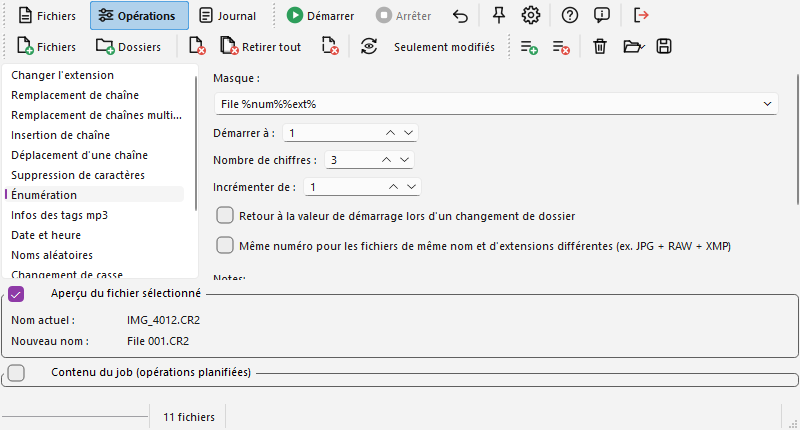

# Page "Opérations"

Cette page affiche les opérations qui peuvent être effectuées sur les fichiers. Choisissez une opération dans la liste de gauche, réglez ses paramètres à droite, puis cliquez sur  « Ajouter » (Ctrl+F2) pour la mettre dans le [job](batch_fr.md). Plusieurs opérations peuvent être empilées : elles sont appliquées l'une après l'autre, dans l'ordre du job. Le job peut aussi être vide : dans ce cas c'est l'opération actuellement affichée qui est appliquée (et prévisualisée).

- [Changer l'extension](#changeext)
- [Remplacement de chaîne](#stringrepl)
- [Remplacement de chaînes multiples](#multstrrepl)
- [Insertion de chaîne](#stringinsert)
- [Déplacement d'une chaîne](#movestring)
- [Suppression de caractères](#chardel)
- [Énumération](#enum)
- [Infos des tags mp3](#mp3)
- [Date et heure](#datetime)
- [Noms aléatoires](#random)
- [Changement de casse](#case)
- [Noms à partir d'une liste](#fromlist)
- [Expressions rationnelles](#regexp)
- [Infos EXIF](#exif)

Cette page possède également des fonctionnalités pour gérer des jobs. En plus de la barre d'outils Fichiers qui est toujours visible, une barre d'outils pour gérer ces jobs est affichée. Pour plus d'informations à propos des jobs, consultez [cette page](batch_fr.md).

En bas de la fenêtre, il y a deux cadres :

- **Aperçu du fichier sélectionné**, qui affiche le nom actuel et le futur nom du fichier sélectionné dans la liste des Fichiers (ou le premier fichier si aucun n'est sélectionné). Cet aperçu est rafraîchi à chaque changement des paramètres d'une opération, vous permettant de voir directement l'impact de ce que vous changez dans ces paramètres.
- **Contenu du job** (caché par défaut), qui affiche les opérations planifiées. Il est décrit sur la page ["Jobs"](batch_fr.md).

Vous pouvez cacher/afficher ces cadres en utilisant la case à cocher à gauche de leur titre.

Sous les paramètres de la plupart des opérations, une zone *Notes* rappelle les tags disponibles. Son lien « voir Aide » ouvre la page [Formatage de chaînes](format_fr.md) (ou la page sur les expressions rationnelles ou sur les tags de métadonnées), et les noms d'autres opérations dans les notes sont des liens qui basculent vers cette opération.

**Fichiers et dossiers.** Les dossiers peuvent aussi être renommés. Par défaut, un nom de dossier est traité comme un nom de fichier sans extension : une opération qui travaille sur l'extension ne fait donc rien sur un dossier. L'option « Le dernier "." d'un nom de dossier délimite l'extension » des [Options](options_fr.md#processing) change cela.

## Changer l'extension {#changeext}

Vous pouvez remplacer l'extension par une nouvelle, ou en ajouter une nouvelle après celle qui existe si vous cochez l'option « Ne pas remplacer l'extension, ajouter la nouvelle extension au nom complet actuel ».

Le point sera ajouté devant l'extension : ne le tapez pas. Pour supprimer l'extension existante, laissez simplement le champ vide. Si vous voulez une extension qui change d'un fichier à l'autre (".001", ".002"...), utilisez l'opération [Énumération](#enum).

## Remplacement de chaîne {#stringrepl}

Vous pouvez remplacer un texte par un autre dans les noms de fichiers. Les options sont :

- **Remplacer toutes les occurences** (cochée par défaut) : si elle n'est pas cochée, seule la première occurence du texte dans chaque nom de fichier sera remplacée.
- **Sensible à la casse** (cochée par défaut).
- **Inclure l'extension dans la recherche** : la recherche se fait dans le nom entier, extension comprise. Par défaut seul le nom sans extension est traité.
- **Appliquer à l'extension plutôt qu'au nom** : seule l'extension (sans son point) est traitée.
- **Utiliser les jokers** (décochée par défaut) : voir plus bas.

Cette opération peut aussi être utilisée pour insérer une chaîne devant ou derrière une autre (si vous ne connaissez pas la position exacte où doit être mise la nouvelle chaîne). Par exemple, si vous voulez insérer "2" après les "test" contenus dans les noms, remplacez "test" par "test2".

Elle peut également être utilisée pour supprimer une chaîne spécifiée : laissez simplement le second champ vide.

Avec l'option « Utiliser les jokers », `*` dans le champ de recherche représente n'importe quel texte (même vide) et `?` n'importe quel caractère ; tous les autres caractères sont recherchés tels quels. Le texte trouvé est le plus court possible : `a*b` dans "a1b2b" trouve "a1b". Par exemple, chercher "IMG\_\*\_copie" et remplacer par "Photo" transforme "IMG_001_copie (1).jpg" en "Photo (1).jpg". Le texte de remplacement est toujours pris tel quel. Pour des motifs plus complexes, utilisez une [expression rationnelle](#regexp).

## Remplacement de chaînes multiples {#multstrrepl}

Vous pouvez entrer ici plusieurs chaînes à remplacer. La colonne de gauche contient les chaînes à rechercher dans les noms, la colonne de droite contient le texte à mettre à la place (qui peut être une chaîne vide). Les remplacements sont faits ligne après ligne, du haut vers le bas de la grille. Les options **Inclure l'extension dans la recherche** (décochée par défaut) et **Sensible à la casse** (cochée par défaut) s'appliquent à toute la grille.

Ceci peut être utilisé pour remplacer des caractères individuels, par exemple remplacer les caractères accentués par leur équivalent latin (un set appelé « Remove west-european accents » est fourni), ou remplacer des chaînes complètes de différentes longueurs.

Vous pouvez sauver le contenu de la grille pour le récupérer plus tard depuis la liste déroulante « Sets prédéfinis ». Tapez un nom dans ce champ et cliquez « Sauver » ; « Supprimer » enlève le set dont le nom est affiché (rien ne se passe si le nom est vide) et « Effacer » vide la grille. Un « / » ou un « \ » dans le nom d'un set est remplacé par un tiret.

Pour ajouter une ligne à la grille, pressez les touches "Ctrl" et "Plus" (+). La nouvelle ligne sera ajoutée avant la ligne sélectionnée. De la même manière, presser les touches "Ctrl" et "Moins" (-) supprimera la ligne courante.

Les boutons « Copier/Exporter » et « Coller/Importer » permettent de facilement exporter et importer le contenu de toute la grille en une fois sous forme de texte brut pour la modifier facilement en Excel ou via un éditeur texte. Chaque ligne de la grille correspond à une ligne de texte, et les deux colonnes sont séparées par une tabulation (c'est ce qu'utilise Excel par défaut comme séparateur de colonne pour le copier/coller).

## Insertion de chaîne {#stringinsert}

Vous pouvez insérer une chaîne à n'importe quelle position, à partir du début ou de la fin. Zéro signifie que la chaîne sera insérée avant le premier caractère existant ou après le dernier.

L'extension n'est pas comprise dans le compte des caractères, d'où une option pour appliquer cela à l'extension plutôt qu'au nom.

Cette opération supporte les tags suivants :

- `%name%` : Nom original du fichier, sans extension
- `%ext%` : Extension originale du fichier, incluant le point
- `%folderN%` : N-ième dossier parent
- `%%` : Un caractère "%"

Consultez le [chapitre consacré au tag "folder" sur la page "Formatage de chaînes"](format_fr.md#folder) pour plus d'informations. Un "\\" dans la chaîne insérée déplace le fichier dans un dossier, voir l'[option « Forcer les dossiers »](options_fr.md#processing).

## Déplacement d'une chaîne {#movestring}

Vous pouvez déplacer un nombre prédéfini de caractères d'un endroit à un autre du nom. Comme pour l'[insertion de chaîne](#stringinsert), les positions "De" et "Vers" commencent à 0 (où 0 = avant le premier caractère ou après le dernier), comptées depuis le début ou depuis la fin du nom.

La position "Vers" compte les caractères restants. Cela signifie que le nombre de caractères indiqué est d'abord supprimé, puis le programme essaie de les insérer à nouveau.

Par exemple, dans la chaîne "abcdef", si vous déplacez 1 caractère de la position 2 (le "c") vers la position 4, il n'apparaîtra pas après le "d" mais après le "e" : puisque le "c" a été retiré, le "d" devient le troisième caractère et le "e" le quatrième.

## Suppression de caractères {#chardel}

Vous pouvez indiquer ici un nombre de caractères à couper. Trois façons de choisir où :

- **À partir de la position** : à partir de la position donnée, comptée depuis le début ou depuis la fin du nom (comme pour l'[insertion de chaîne](#stringinsert)) ;
- **Après la chaîne** : les caractères qui suivent la première occurence de la chaîne donnée ;
- **Avant la chaîne** : les caractères qui précèdent la première occurence de la chaîne donnée.

Si la chaîne n'est pas trouvée, rien n'est supprimé. L'option « Appliquer à l'extension plutôt qu'au nom » travaille sur l'extension.

## Énumération {#enum}

Pour cette opération, vous devez indiquer un masque. Ce masque doit contenir au moins le tag %num%, pour indiquer au programme où mettre le nombre qu'il va générer.

- `%name%` : Nom original du fichier, sans extension
- `%ext%` : Extension originale du fichier, incluant le point
- `%num%` : Le numéro courant
- `%folderN%` : N-ième dossier parent

Par exemple, si vous voulez appeler vos images "Fichier 0001.jpg", "Fichier 0002.jpg", etc. vous pouvez entrer `Fichier %num%%ext%`. Vous pouvez mettre ".jpg" à la place de "%ext%" si vous ne voulez pas garder l'extension d'origine (ou si tous les fichiers sont des JPEG).

Consultez la page ["Formatage de chaînes"](format_fr.md) pour plus d'informations sur les masques et les tags.

"Démarrer à" est le numéro à donner au premier fichier (il peut être négatif). "Nombre de chiffres" représente le nombre minimum de chiffres à écrire (si le numéro courant a moins de chiffres, des zéros seront ajoutés devant ; mettez ce champ à 1 si vous ne voulez pas de zéros devant les numéros). "Incrémenter de" est la valeur ajoutée pour chaque fichier (elle peut être négative). Les numéros suivent l'ordre de la liste des Fichiers : triez la liste d'abord si vous voulez un autre ordre.

Si les fichiers sont groupés par dossiers (c'est-à-dire que le tri principal est le nom de dossier, de sorte que les contenus des dossiers ne sont pas mélangés dans la liste), vous pouvez utiliser l'option « Retour à la valeur de démarrage... ». Elle repart de la valeur "Démarrer à" quand le fichier courant est dans un autre dossier que le précédent. Cela permet de faire le même genre d'énumération dans beaucoup de dossiers sans devoir faire l'opération pour chaque dossier séparément.

L'option « Même numéro pour les fichiers de même nom... » donne le même numéro aux fichiers d'un même dossier qui ont le même nom (sans extension) mais des extensions différentes, par exemple `IMG_1234.JPG` et `IMG_1234.CR2` venant d'un appareil photo. Un fichier dont l'extension est déjà dans le groupe reçoit un nouveau numéro. Les fichiers doivent se suivre dans la liste (triez par nom).

## Infos des tags mp3 {#mp3}

Ici encore vous devez entrer un masque. Les tags sont lus dans les informations ID3 du fichier : ID3v2 (2.2, 2.3 et 2.4) au début du fichier et ID3v1 / v1.1 à sa fin. Quand les deux existent, les valeurs v2 sont utilisées, et la v1 complète ce que la v2 n'a pas. Consultez la page ["Formatage de chaînes"](format_fr.md) pour plus d'informations.

- `%author%` : Auteur/Artiste
- `%title%` : Titre de la chanson
- `%album%` : Nom de l'album
- `%year%` : Année
- `%genre%` : Genre/Catégorie (en texte)
- `%comm%` : Commentaire
- `%track%` : Numéro de piste (vide si le fichier n'en a pas)

Les tags `%name%`, `%ext%`, `%folderN%` et `%%` sont aussi disponibles, ainsi que la fonction `$if` (voir ["Formatage de chaînes"](format_fr.md#if)).

Comme un tag mp3 peut contenir n'importe quel caractère, les caractères interdits dans un nom de fichier sont toujours remplacés dans les valeurs des tags : les guillemets (") deviennent des apostrophes ('), les points d'interrogation un point, et les caractères `\ / : * < > |` ainsi que les caractères de contrôle un tiret (un caractère NUL est simplement supprimé).

L'option « Numéro de piste sur deux chiffres » ajoute un zéro devant le numéro de piste quand il n'a qu'un chiffre ("1" devient "01").

Un fichier sans information ID3 n'est pas renommé : le journal l'indique (ligne bleue).

## Date et heure {#datetime}

Cette opération utilise un autre système de masque. Les tags sont de simples lettres :

- `f` : Nom de fichier original (sans extension)
- `e` : Extension originale (incluant le point)
- `d` : Jour sans zéro devant (1-31)
- `dd` : Jour avec zéro devant (01-31)
- `ddd` : Jour, nom court (lun.-dim.)
- `dddd` : Jour, nom complet (lundi-dimanche)
- `m` : Mois sans zéro devant (1-12)
- `mm` : Mois avec zéro devant (01-12)
- `mmm` : Mois, nom court (janv.-déc.)
- `mmmm` : Mois, nom complet (janvier-décembre)
- `yy` : Année, nombre à 2 chiffres (00-99)
- `yyyy` : Année, nombre à 4 chiffres (0000-9999)
- `h` : Heure sans zéro devant (0-23)
- `hh` : Heure avec zéro devant (00-23)
- `n` : Minute sans zéro devant (0-59)
- `nn` : Minute avec zéro devant (00-59)
- `s` : Seconde sans zéro devant (0-59)
- `ss` : Seconde avec zéro devant (00-59)
- `z` : Milliseconde sans zéros devant (0-999)
- `zzz` : Milliseconde avec zéros devant (000-999)
- `am/pm` : Utilise l'horloge de 12 heures pour toutes les heures du masque, et écrit "am" ou "pm" (en majuscules si vous le tapez en majuscules)
- `a/p` : Pareil, mais écrit "a" ou "p"
- `ampm` : Pareil, mais écrit "AM" ou "PM"

Les noms des jours et des mois sont dans la langue de votre système. Si m ou mm suit immédiatement h ou hh (ou précède s ou ss), c'est la minute et non le mois qui est utilisée.

Les tags "c", "ddddd" et "dddddd" du programme d'origine (date au format de Windows) ne sont pas disponibles dans Ant Renamer Qt ; utilisez les lettres ci-dessus pour construire le format voulu.

Faites attention avec les formats de date et d'heure : les caractères "/" et ":" ne peuvent pas être utilisés dans un nom de fichier. Si vous voulez des séparateurs entre les nombres, insérez-les entre guillemets, comme expliqué dans les paragraphes suivants.

Ici tous les caractères qui ne font pas partie du masque devraient être mis entre guillemets (simples ou doubles). Je recommande d'utiliser les guillemets doubles ("...") plutôt que les simples (apostrophes '...') pour pouvoir mettre des apostrophes à l'intérieur. Une exception : les lettres « f » (nom du fichier) et « e » (extension) sont remplacées même entre guillemets simples, donc un texte qui contient un « f » ou un « e » doit être mis entre guillemets doubles.

Voici quelques exemples valides :

- `yyyy'-'mm'-'dde` : Utilise le format de date aaaa-mm-jj, force le séparateur à "-", et garde l'extension d'origine.
- `"a'b" yyyymmdd".txt"` : Exemple d'apostrophe à l'intérieur de guillemets. Une extension ".txt" est imposée.
- `yy'-'mm'-'dd hh'-'nn'-'sse` : Inclut aussi l'heure dans le nom, au format 24 heures.
- `yy'-'mm'-'dd hh'-'nn'-'ss am/pme` : Pareil, mais au format 12 heures (avec am/pm) au lieu de 24 heures. Le am/pm est affiché après toute l'heure.

Vous pouvez choisir d'utiliser soit la date/heure de création, soit la date/heure de dernière modification. La première est la date à laquelle le fichier a été mis sur le disque, la seconde celle où le contenu du fichier a été modifié. Si vous avez récemment mis un vieux fichier sur un nouveau disque, la date de création peut être plus récente que la date de modification. La plupart du temps c'est la date de modification qui est utilisée. Tous les systèmes de fichiers ne conservent pas la date de création (elle manque souvent sous Linux) : la date de modification est alors utilisée à la place.

« Décalage » décale la date, en secondes (négatif pour reculer dans le temps). C'est utile, par exemple, pour corriger l'horloge d'un appareil photo réglée sur le mauvais fuseau horaire : 3600 = une heure.

Comme plusieurs fichiers peuvent avoir la même date (ou heure), l'option « Ajouter un suffixe si plus d'un fichier a la même date/heure » ajoute un long nombre à un nom qui existe déjà.

## Noms aléatoires {#random}

En utilisant le même système de masque que l'[Énumération](#enum) et les [infos mp3](#mp3), vous pouvez générer ici de nouveaux noms qui contiendront une partie aléatoire. Comme dans ces deux opérations, les tags %name% et %ext% sont aussi disponibles.

Le tag `%random%` mettra une chaîne aléatoire, générée selon une de ces options :

- **Nombre aléatoire (8 chiffres)** : Génère 8 chiffres au hasard.
- **Compteur Windows** : Ce n'est pas vraiment un nombre aléatoire, c'est un compteur de millisecondes (les 32 bits de poids faible de l'horloge), donc ces nombres sont séquentiels. Le programme attend quelques millisecondes entre deux fichiers pour donner à chacun sa propre valeur. Le nom de cette option vient du programme d'origine.
- **GUID** : Ces chaînes spéciales sont de très longs identifiants, conçus pour être uniques. Vous pouvez être sûr de ne jamais obtenir deux GUID identiques. Le seul inconvénient est qu'ils ne sont pas très beaux, par exemple "{FC7F6B42-A25A-47B1-96A7-52A12BC36A02}" (accolades comprises : les caractères "{" et "}" sont permis dans les noms de fichiers).

## Changement de casse {#case}

Avec cette opération, seule la casse (majuscules/minuscules) des lettres change, donc seule l'écriture du nom change. Le fichier est renommé aussi sous Windows ("photo.jpg" devient "Photo.jpg"), même si Windows considère les deux comme le même nom ; sous Linux ce sont deux noms différents.

Vous pouvez faire différents types de changements :

- **Mettre en majuscule la première lettre suivant un des caractères suivants** : habituellement utilisé pour faire des noms en casse mixte. Le reste du nom est mis en minuscules, et vous devez taper dans le champ les caractères qui commencent un mot (espace, tiret, point, plus, parenthèse...). La première lettre du nom est toujours en majuscule.
- **Mettre en majuscule la première lettre du nom** : la première lettre en majuscule, toutes les autres en minuscules.
- **Tout en majuscules**.
- **Tout en minuscules**.

Il vaut généralement mieux garder cochée l'option « Utiliser les options régionales de Windows pour traiter les caractères accentués » : toutes les lettres, accentuées comprises, sont alors converties (é en É). Si cette option n'est pas cochée, seules les lettres latines standard (a..z) sont modifiées.

Par défaut l'extension est laissée telle quelle. « Appliquer également à l'extension » change aussi la casse de l'extension, et « Appliquer à l'extension plutôt qu'au nom » ne change que l'extension.

## Noms à partir d'une liste {#fromlist}

Pour cette opération, il suffit de donner une liste des nouveaux noms (un par ligne), tapée dans la zone ou chargée depuis un fichier texte avec « Ouvrir... ». « Sauver... » enregistre la liste dans un fichier et « Vider » l'efface. Ant Renamer renommera le premier fichier avec la première ligne, le deuxième avec la deuxième, etc. (dans l'ordre de la liste des Fichiers).

Par défaut chaque ligne est prise comme un nom complet, mais si vous ne voulez pas écraser les extensions (c'est-à-dire prendre le nom sans extension dans la liste puis ajouter l'extension d'origine), vous pouvez cocher l'option « Ajouter l'extension d'origine du fichier ».

Vous pouvez aussi simplement donner une liste d'extensions, et cocher l'option « Utiliser les éléments comme extensions plutôt que comme noms ». Les noms ne seront alors pas modifiés.

Si la liste est trop courte, les fichiers qui n'ont pas de ligne correspondante ne seront pas renommés. Pareil quand une ligne vide est trouvée dans le fichier. Le journal l'indique.

## Expressions rationnelles {#regexp}

Si vous connaissez la syntaxe de ces expressions, vous pourrez extraire rapidement une partie des noms de fichiers pour générer un nouveau nom en une seule étape plutôt que de devoir combiner plusieurs opérations. Vous pouvez même obtenir des changements impossibles avec les opérations classiques de déplacement/insertion/suppression.

Vous devez fournir au programme une expression rationnelle et une chaîne "nouveau nom" contenant des tags $*nn* (où *nn* est un nombre) qui indiquent où placer les caractères trouvés dans le nom de fichier d'origine. L'expression est appliquée au nom de fichier entier, extension comprise.

Pour plus d'informations sur la syntaxe de l'expression rationnelle, avec des exemples, consultez [la page qui lui est consacrée](regexp_fr.md).

## Infos EXIF {#exif}

En utilisant le même système de masque que plusieurs opérations décrites plus haut, vous pouvez générer avec cette opération un nouveau nom de fichier basé sur les données EXIF contenues dans les images (JPEG, et fichiers basés sur TIFF comme la plupart des fichiers RAW). Cela peut être très utile, par exemple, en remplacement de l'opération [Date et heure](#datetime) si les dates de vos photos ne sont pas conservées quand vous les transférez depuis votre appareil photo numérique.

Consultez la page ["Formatage de chaînes"](format_fr.md) pour plus d'informations, y compris la fonction `$if`. En plus des tags EXIF, les données IPTC et XMP (mots-clés, titre, auteur, lieu, note...) peuvent aussi être utilisées. Tous les tags disponibles sont listés [sur cette page dédiée](metadata_tags_fr.md). Le tag `%datetime%` (ou `%datetimeoriginal%`) est la date et l'heure de prise de vue.

« Décalage » décale tous les tags de date, en secondes (3600 = une heure), comme dans l'opération [Date et heure](#datetime).

Le tag `%num%` est un compteur, comme dans l'opération [Énumération](#enum) (mêmes options, y compris « Retour à la valeur de démarrage... » et « Même numéro pour les fichiers de même nom... », pratique pour donner le même numéro à un JPEG et à son fichier RAW).

Un fichier qui ne contient aucune information EXIF, IPTC ou XMP n'est pas renommé : le journal indique « Pas d'info EXIF trouvée ».

Le fichier XMP associé d'une image (`IMG.xmp` ou `IMG.CR2.xmp`) est lu avec l'image et l'emporte sur le XMP intégré, ce qui rend disponibles les mots-clés et la note d'un fichier RAW. Quand l'image est renommée, ses fichiers associés (`.xmp`, `.dop`, `.pp3`... et, pour un JPEG, son fichier RAW) sont renommés avec elle : voir l'option dans les [Options](options_fr.md), page *Traitement*.
