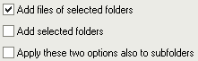

# Ajout de fichiers & dossiers

Il y a plusieurs manières d'ajouter des fichiers à la liste :

- [Bouton "Fichiers"](#addfiles) dans la fenêtre principale
- [Bouton "Dossiers"](#addfolders) dans la fenêtre principale
- [Drag & drop (glisser-déposer) de fichiers](#dragdrop) depuis le gestionnaire de fichiers (Explorateur Windows, Nautilus, Dolphin...)
- [Menu contextuel du gestionnaire de fichiers](#explorer) (Windows)
- [Ligne de commande](#cmdline)

## Bouton "Fichiers" {#addfiles}

Lorsque vous cliquez sur le bouton  "Fichiers" (F2) une fenêtre standard de sélection de fichiers apparaît. Cette fenêtre est contrôlée par le système, donc elle fonctionne comme dans d'autres programmes ; vous pouvez sélectionner plusieurs fichiers avec Ctrl et Maj. Une chose à savoir est que l'ordre des fichiers qui seront renvoyés par cette fenêtre n'est pas spécialement l'ordre que vous voyez. Si l'ordre compte (par exemple pour une énumération), triez la liste ensuite en cliquant sur un en-tête de colonne, voir la [page Fichiers](files_fr.md).

Il peut également y avoir quelques problèmes de vitesse lorsque vous tentez d'ajouter des milliers de fichiers. La fenêtre peut prendre très longtemps à envoyer les noms de fichiers au programme. Si c'est le cas, utilisez la fonction d'ajout de ["Dossiers"](#addfolders) à la place.

## Bouton "Dossiers" {#addfolders}

Lorsque vous cliquez sur le bouton  "Dossiers" (F3) une fenêtre apparaît, montrant les lecteurs et les dossiers de l'ordinateur sous forme d'arbre et vous permettant de choisir un ou plusieurs dossiers (Ctrl et Maj pour en choisir plusieurs). Cette fenêtre n'a pas été faite que pour ajouter des dossiers à la liste, mais aussi pour y ajouter leur contenu.

Quelques options dans le bas de la fenêtre permettent de spécifier ce qui doit être ajouté à la liste :  

  

La première (« Ajouter les fichiers des dossiers sélectionnés ») spécifie si les fichiers contenus dans le(s) dossier(s) sélectionné(s) doivent être ajoutés ou non. La seconde (« Ajouter les dossiers sélectionnés ») spécifie si les dossiers sélectionnés doivent être ajoutés ou non. La troisième (« Appliquer ces deux options aux sous-dossiers également ») spécifie si les sous-dossiers des dossiers sélectionnés doivent être inclus ou non (cela s'applique à tous les sous-dossiers, pas juste au premier niveau). Les trois choix sont mémorisés pour la fois suivante.

Pour ajouter les fichiers d'un dossier situé sur le réseau, le [drag & drop](#dragdrop) ou la [ligne de commande](#cmdline) peuvent être plus faciles que cette fenêtre.

## Drag & drop (glisser-déposer) de fichiers {#dragdrop}

Vous pouvez glisser des fichiers et des dossiers depuis le gestionnaire de fichiers (Explorateur Windows et autres programmes qui sont compatibles avec lui, comme Total Commander, ou le gestionnaire de fichiers de votre bureau Linux) directement vers la fenêtre principale d'Ant Renamer. Ceci est en général beaucoup plus facile pour ajouter des fichiers plutôt que de les sélectionner dans la fenêtre d'ajout de fichiers.

Par défaut, lorsque vous déposez des fichiers une fenêtre apparaît. Elle vous permet de choisir comment vous voulez ajouter ces fichiers. Ces options sont les mêmes que celles qui sont disponibles dans la fenêtre d'ajout de [Dossiers](#addfolders). Une option étiquetée "Ne plus afficher cette fenêtre" permet de conserver les paramètres sélectionnés pour les prochains drag & drop, pour que la fenêtre ne soit plus affichée. Si vous cochez cette option et désirez ensuite l'annuler (ou changer les paramètres), vous pouvez faire cela dans la page "Fichiers & Dossiers" de la [fenêtre des Options](options_fr.md#files). Pour faire réapparaître cette fenêtre une seule fois sans changer son comportement par défaut, vous pouvez maintenir enfoncée la touche Ctrl ou Maj lorsque vous déposez les fichiers. Cela permet, par exemple, d'ajouter un dossier à la liste alors que le comportement par défaut consiste en l'ajout des fichiers uniquement.

Les mêmes limitations que pour la fenêtre d'ajout de fichiers s'appliquent (ordre des fichiers et problèmes de vitesse avec de nombreux fichiers).

## Menu contextuel du gestionnaire de fichiers (Windows) {#explorer}

Sous Windows, le programme peut ajouter une entrée « Ajouter à Ant Renamer Qt » au menu contextuel des fichiers et des dossiers de l'Explorateur Windows. Elle s'active dans les [Options](options_fr.md#files), page "Fichiers & Dossiers". Quand plusieurs éléments sont sélectionnés, ils arrivent tous ensemble dans la fenêtre d'Ant Renamer déjà ouverte (le programme est lancé s'il ne tourne pas). Sous Windows 11, l'entrée se trouve dans le menu « Afficher plus d'options » (ou Maj+F10).

## Ligne de commande {#cmdline}

Des fichiers peuvent aussi être ajoutés quand le programme est lancé depuis la ligne de commande, voir les [paramètres](params_fr.md). Les jokers (`*` et `?`) y sont acceptés.
