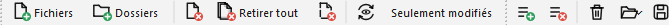

# Liste prédéfinie (job)

Ant Renamer peut stocker et récupérer des listes prédéfinies d'opérations, appelées ici "jobs". Ils peuvent être gérés depuis la [page "Opérations"](actions_fr.md).

En plus de la barre d'outils Fichiers qui est toujours visible, une barre d'outils pour gérer ces jobs est affichée :  

Voici ses commandes :

- Le bouton  "Ajouter" (Ctrl+F2, « Ajouter au job » dans l'info-bulle) ajoutera l'opération sélectionnée et ses paramètres à la liste.
- Le bouton  "Suppr. sél." (Maj+F6) retirera de la liste les éléments qui sont sélectionnés.
- Le bouton  "Vider" (Maj+F7) retirera de la liste toutes les actions prédéfinies.
- Le bouton  "Ouvrir..." (Ctrl+O) affichera une fenêtre standard de sélection de fichier, vous permettant de sélectionner un fichier de job à charger dans la liste.
- Le bouton  "Sauver..." (Ctrl+S) affichera une fenêtre standard de sélection de fichier, vous permettant de choisir où sauver le contenu de la liste pour une utilisation ultérieure.

Ces fichiers de jobs peuvent être utilisés pour combiner de multiples actions dans un seul processus de renommage. Ils peuvent être sauvés pour être réutilisés plus tard, ou pour être utilisés depuis la [ligne de commande](params_fr.md).

Ils sont stockés en tant que fichiers XML, mais ils ont une extension ".arb" (signifiant "Ant Renamer Batch"). Les fichiers d'Ant Renamer 2 peuvent être ouverts par Ant Renamer Qt et inversement.

Si le job est vide quand vous cliquez sur "Démarrer" (ou actualisez l'aperçu), c'est l'opération affichée sur la page Opérations qui est appliquée, une fois, avec ses paramètres actuels.

La liste des actions actuellement planifiées est affichée dans le panneau inférieur, appelé "Contenu du job". S'il n'est pas visible, vous pouvez l'afficher en cliquant sur la case à cocher à gauche de son titre.

Vous pouvez déplacer les éléments vers le haut et vers le bas de la liste par drag & drop ou en utilisant les quatre icônes additionnelles qui apparaissent dans la barre d'outils lorsque le panneau de job est visible.

Dans la disposition classique, après avoir été ajouté, un élément ne peut pas être modifié : vous devez l'enlever, redéfinir ses paramètres et l'ajouter à nouveau. Dans la disposition moderne d'Ant Renamer Qt, il peut être modifié : double-cliquez dessus pour charger ses paramètres dans l'éditeur, puis cliquez sur "Valider la modification" ou "Modifier", voir [modifier une opération du job](modernui_fr.md#edit).
