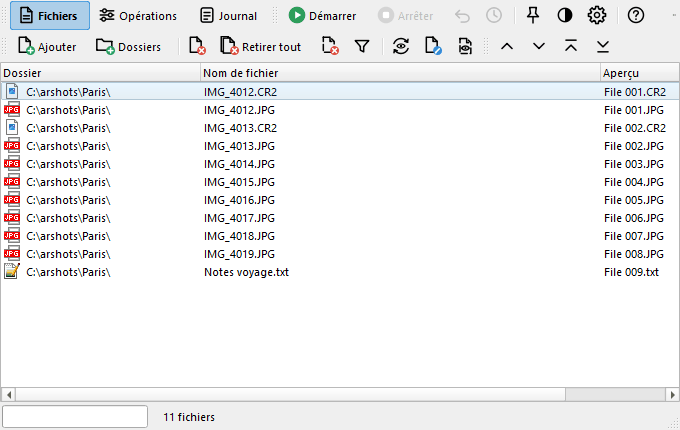
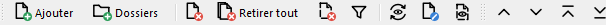
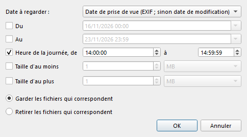
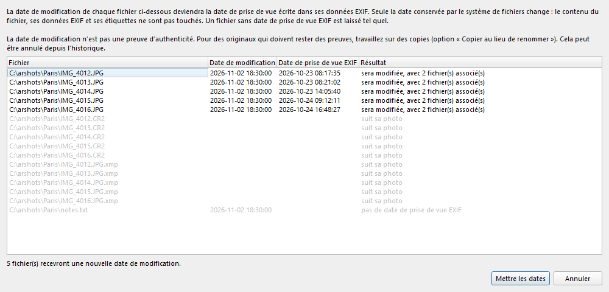

# Page "Fichiers"

Cette page affiche la liste des fichiers (et dossiers) qui seront renommés.

Les icônes de la barre d'outils utilisées pour ajouter et retirer des fichiers de la liste sont toujours affichées, même si la page "Fichiers" n'est pas active.  

Voici ses commandes :

- Le bouton  "Fichiers" (F2) affiche une fenêtre standard de sélection de fichiers dans laquelle vous pouvez choisir les fichiers à ajouter. Consultez [cette page](addfiles_fr.md#addfiles) pour plus de détails.
- Le bouton  "Dossiers" (F3) affiche une fenêtre de sélection de dossier, qui vous permet d'ajouter des fichiers et des dossiers comme décrit sur [cette page](addfiles_fr.md#addfolders).
- Le bouton  "Retirer sélec." (F6) retire de la liste les fichiers qui sont sélectionnés. Les fichiers ne sont pas supprimés du disque.
- Le bouton  "Retirer tout" (F7) vide la liste de fichiers.
- Le bouton  "Retirer manquants" (F8) retire de la liste les fichiers qui n'existent plus sur le disque (fichiers manquants). Cela peut arriver si, par exemple, après le traitement des fichiers vous en déplacez quelques-uns à l'aide du gestionnaire de fichiers.
- Le bouton  "Filtrer les fichiers" (F4) garde, ou retire, les fichiers de la liste qui correspondent à une date, une heure de la journée ou une taille, voir [plus bas](#filter).
- Le bouton  "Aperçu" (F5) rafraîchit le contenu de la colonne "Aperçu" (et l'affiche si elle n'est pas déjà visible). Cette prévisualisation n'est pas faite automatiquement pour des raisons de performance. Elle tient compte des opérations planifiées (le [job](batch_fr.md), ou l'opération actuellement affichée si le job est vide).
- Le bouton "Seulement modifiés" (à côté) masque, dans la liste, les fichiers dont le nom ne change pas dans l'aperçu. C'est seulement un filtre d'affichage : les fichiers masqués restent dans la liste et sont renommés normalement. Ils sont aussi désélectionnés : "Retirer sélec." et les boutons de déplacement ne les touchent jamais. Actualisez d'abord l'aperçu, pour avoir quelque chose à comparer. Pratique pour contrôler les quelques fichiers concernés dans une grande liste, par exemple pour remplacer seulement les trémas.
- Le bouton "Fichiers cachés" (à côté) affiche ou masque les fichiers cachés et système de la liste (`desktop.ini`, `.git`...). Désactivé par défaut : ils sont masqués **et ignorés par toutes les opérations** (pas renommés, pas comptés par une énumération). Activez-le pour les voir et les traiter ; un avertissement s'affiche alors avant un renommage. L'option Options > Fichiers & Dossiers décide si l'ajout d'un dossier les met dans la liste.

Lorsque vous cliquez avec le bouton droit sur les en-têtes de la liste, un menu apparaît. Il vous permet de choisir quelles colonnes doivent être affichées ou non parmi les suivantes : Dossier, Nom de fichier, Chemin complet, Ext. (Extension), Aperçu, Taille, Date de création, Date de modification. Les en-têtes peuvent être redimensionnés et déplacés pour changer la largeur et l'ordre des colonnes. Une colonne au moins reste visible.

Il y a également quatre boutons permettant de déplacer les éléments dans la liste (haut, bas, début, fin ; Ctrl+Haut, Ctrl+Bas, Ctrl+Maj+Haut, Ctrl+Maj+Bas), pour changer l'ordre du traitement. Vous pouvez aussi faire un "drag & drop" des éléments dans la liste pour changer leur ordre.

Cet ordre peut encore être changé en triant les fichiers à l'aide d'un clic sur les en-têtes de colonnes (un nouveau clic inverse l'ordre). Le tri change réellement l'ordre de la liste, c'est donc aussi l'ordre dans lequel les fichiers sont traités : il décide, par exemple, quel fichier reçoit quel numéro dans une [Énumération](actions_fr.md#enum). Dans Ant Renamer Qt, un clic sur un en-tête de colonne trie par défaut les colonnes de texte dans l'ordre naturel (« fichier 2 » avant « fichier 10 »). Les [options](options_fr.md#files) permettent d'obtenir à la place l'ordre alphabétique du programme d'origine. Pour désactiver ce tri automatique, vous pouvez cliquer avec le bouton droit sur les en-têtes de la liste et sélectionner la commande "Non trié".

Lorsque vous cliquez avec le bouton droit sur la liste, un menu apparaît avec les commandes pour retirer les fichiers sélectionnés ou tous les fichiers, **filtrer les fichiers** et **mettre leurs dates d'après l'EXIF** (voir plus bas), sélectionner tous les éléments de la liste, n'en sélectionner aucun ou inverser la sélection, actualiser l'aperçu, et l'exporter : « Exporter l'aperçu... » écrit les fichiers affichés (les filtres « Seulement modifiés » et « Fichiers cachés » s'appliquent) dans un fichier CSV (colonnes Dossier, Nom, Nouveau nom ; point-virgule, UTF-8 avec BOM pour qu'Excel et LibreOffice lisent les accents) ou dans un fichier texte avec les seuls nouveaux noms, un par ligne. Un fichier sans aperçu garde son nom actuel : actualisez donc d'abord l'aperçu.

L'icône de chaque fichier (selon son extension) peut être affichée, et un double-clic peut ouvrir le fichier avec le programme qui lui est associé : voir les [options](options_fr.md#display).

Des dossiers peuvent aussi se trouver dans la liste (voir [ajout de fichiers & dossiers](addfiles_fr.md)). Ils sont renommés comme les fichiers, dans l'ordre de la liste ; les fichiers de la liste qui se trouvent dans un dossier renommé le suivent.

Le nombre de fichiers de la liste est affiché en bas de la fenêtre.

### Filtrer les fichiers {#filter}

*(Ant Renamer Qt)* Le bouton « Filtrer les fichiers... » (F4, un entonnoir) de la barre d'outils, aussi dans le menu du clic droit, garde, ou retire, les fichiers de la liste qui correspondent à ce que vous cochez : une période (« Du », « Au »), une heure de la journée (« Heure de la journée, de ... à ... », par exemple tout ce qui a été pris entre 14 h et 15 h quel que soit le jour ; de 22 h à 2 h marche à cheval sur minuit) et une taille (« Taille d'au moins », « Taille d'au plus »). Tous les critères cochés doivent être vrais ensemble.

La date regardée se choisit au-dessus : la date de modification, la date de création (que tous les systèmes de fichiers Linux ne gardent pas : un fichier qui n'en a pas ne correspond jamais) ou la date de prise de vue (la date EXIF d'une image, sinon sa date de modification). Les limites de taille concernent les fichiers ; un dossier est jugé sur ses dates.

Les fichiers sont seulement retirés de la liste : rien n'est touché sur le disque, et vous pouvez les rajouter. Pour corriger un filtre, appuyez de nouveau sur le bouton : les derniers critères sont affichés, et « Remettre d'abord les fichiers retirés par le filtre précédent » (coché) rend les fichiers que le filtre avait retirés (chacun juste après le fichier qui le précédait, à la fin si ce fichier a disparu) avant d'appliquer le nouveau filtre. Tant qu'un filtre masque des fichiers, le nombre de fichiers en bas de la fenêtre passe en orange (« 12 fichiers, 340 masqués par le filtre ») et le bouton Filtrer reste enfoncé. Le bouton « Effacer le filtre » (ou aucun critère coché, avec la remise des fichiers) rend tous les fichiers qui avaient été retirés et ne filtre rien. « Tout retirer » les oublie.

### Mettre les dates d'après l'EXIF {#setdates}

*(Ant Renamer Qt)* Le menu du clic droit de la liste propose « Mettre les dates d'après l'EXIF... ». Il donne aux fichiers, comme date de modification, la date de prise de vue écrite dans leurs données EXIF (ou dans leur fichier XMP associé) : utile pour des photos qui ont été copiées et dont la date a été écrasée. Ce n'est jamais automatique : un tableau montre l'ancienne et la nouvelle date de chaque fichier, et rien ne change avant que vous appuyiez sur « Mettre les dates » (« Annuler » est le bouton par défaut).

Le tableau liste chaque fichier de la liste avec sa date de modification, sa date de prise de vue EXIF et ce qui va se passer : *sera modifiée* (avec le nombre de fichiers associés qui la suivent), *déjà correcte*, *pas de date de prise de vue EXIF*, *suit sa photo* (un fichier associé qui est aussi dans la liste : sa photo l'emmène avec elle), *fichier caché* (les fichiers cachés sont laissés tels quels, comme pour un renommage) ou *un dossier n'a pas de date EXIF*.

Seule la date de modification gardée par le système de fichiers change. Le contenu du fichier, ses données EXIF et ses étiquettes ne sont pas touchés, et aucune date n'est saisie à la main ni inventée : un fichier sans date de prise de vue EXIF (ou avec une date 0000:00:00), un dossier et un fichier caché sont laissés tels quels, et le journal dit pourquoi. Les fichiers associés (`.xmp`, `.dop`, le RAW d'un JPEG, `IMG.DNG.xmp`...) suivent leur photo comme dans un renommage ([Options](options_fr.md#processing), « Renommer aussi les fichiers associés ») : ils reçoivent la même date. Un fichier en lecture seule, ou qu'un autre programme garde ouvert, reçoit aussi sa date. Le journal garde l'ancienne et la nouvelle date, et l'historique (Annuler) remet les anciennes dates, sauf si le fichier a été modifié depuis.

**La date de modification n'est pas une preuve d'authenticité.** Pour des originaux qui doivent rester des preuves, travaillez sur des copies (option « Copier au lieu de renommer »). En ligne de commande, le paramètre `--set-dates-from-exif` remplace le renommage, voir les [paramètres de la ligne de commande](params_fr.md).
