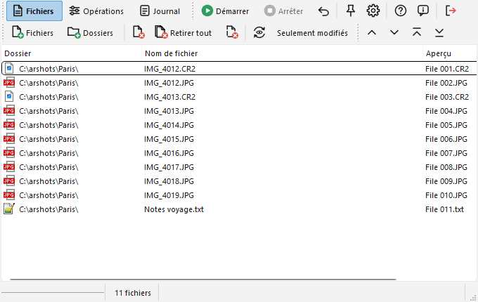
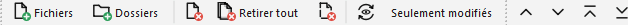

# Page "Fichiers"

Cette page affiche la liste des fichiers (et dossiers) qui seront renommés.

Les icônes de la barre d'outils utilisées pour ajouter et retirer des fichiers de la liste sont toujours affichées, même si la page "Fichiers" n'est pas active.  

Voici ses commandes :

- Le bouton  "Fichiers" (F2) affiche une fenêtre standard de sélection de fichiers dans laquelle vous pouvez choisir les fichiers à ajouter. Consultez [cette page](addfiles_fr.md#addfiles) pour plus de détails.
- Le bouton  "Dossiers" (F3) affiche une fenêtre de sélection de dossier, qui vous permet d'ajouter des fichiers et des dossiers comme décrit sur [cette page](addfiles_fr.md#addfolders).
- Le bouton  "Retirer sélec." (F6) retire de la liste les fichiers qui sont sélectionnés. Les fichiers ne sont pas supprimés du disque.
- Le bouton  "Retirer tout" (F7) vide la liste de fichiers.
- Le bouton  "Retirer manquants" (F8) retire de la liste les fichiers qui n'existent plus sur le disque (fichiers manquants). Cela peut arriver si, par exemple, après le traitement des fichiers vous en déplacez quelques-uns à l'aide du gestionnaire de fichiers.
- Le bouton  "Aperçu" (F5) rafraîchit le contenu de la colonne "Aperçu" (et l'affiche si elle n'est pas déjà visible). Cette prévisualisation n'est pas faite automatiquement pour des raisons de performance. Elle tient compte des opérations planifiées (le [job](batch_fr.md), ou l'opération actuellement affichée si le job est vide).
- Le bouton "Seulement modifiés" (à côté) masque, dans la liste, les fichiers dont le nom ne change pas dans l'aperçu. C'est seulement un filtre d'affichage : les fichiers masqués restent dans la liste et sont renommés normalement. Ils sont aussi désélectionnés : "Retirer sélec." et les boutons de déplacement ne les touchent jamais. Actualisez d'abord l'aperçu, pour avoir quelque chose à comparer. Pratique pour contrôler les quelques fichiers concernés dans une grande liste, par exemple pour remplacer seulement les trémas.
- Le bouton "Fichiers cachés" (à côté) affiche ou masque les fichiers cachés et système de la liste (`desktop.ini`, `.git`...). Désactivé par défaut : ils sont masqués **et ignorés par toutes les opérations** (pas renommés, pas comptés par une énumération). Activez-le pour les voir et les traiter ; un avertissement s'affiche alors avant un renommage. L'option Options > Fichiers & Dossiers décide si l'ajout d'un dossier les met dans la liste.

Lorsque vous cliquez avec le bouton droit sur les en-têtes de la liste, un menu apparaît. Il vous permet de choisir quelles colonnes doivent être affichées ou non parmi les suivantes : Dossier, Nom de fichier, Chemin complet, Ext. (Extension), Aperçu, Taille, Date de création, Date de modification. Les en-têtes peuvent être redimensionnés et déplacés pour changer la largeur et l'ordre des colonnes. Une colonne au moins reste visible.

Il y a également quatre boutons permettant de déplacer les éléments dans la liste (haut, bas, début, fin ; Ctrl+Haut, Ctrl+Bas, Ctrl+Maj+Haut, Ctrl+Maj+Bas), pour changer l'ordre du traitement. Vous pouvez aussi faire un "drag & drop" des éléments dans la liste pour changer leur ordre.

Cet ordre peut encore être changé en triant les fichiers à l'aide d'un clic sur les en-têtes de colonnes (un nouveau clic inverse l'ordre). Le tri change réellement l'ordre de la liste, c'est donc aussi l'ordre dans lequel les fichiers sont traités : il décide, par exemple, quel fichier reçoit quel numéro dans une [Énumération](actions_fr.md#enum). Dans Ant Renamer Qt, un clic sur un en-tête de colonne trie par défaut les colonnes de texte dans l'ordre naturel (« fichier 2 » avant « fichier 10 »). Les [options](options_fr.md#files) permettent d'obtenir à la place l'ordre alphabétique du programme d'origine. Pour désactiver ce tri automatique, vous pouvez cliquer avec le bouton droit sur les en-têtes de la liste et sélectionner la commande "Non trié".

Lorsque vous cliquez avec le bouton droit sur la liste, un menu apparaît avec les commandes pour retirer les fichiers sélectionnés ou tous les fichiers, sélectionner tous les éléments de la liste, n'en sélectionner aucun ou inverser la sélection, et actualiser l'aperçu.

L'icône de chaque fichier (selon son extension) peut être affichée, et un double-clic peut ouvrir le fichier avec le programme qui lui est associé : voir les [options](options_fr.md#display).

Des dossiers peuvent aussi se trouver dans la liste (voir [ajout de fichiers & dossiers](addfiles_fr.md)). Ils sont renommés comme les fichiers, dans l'ordre de la liste ; les fichiers de la liste qui se trouvent dans un dossier renommé le suivent.

Le nombre de fichiers de la liste est affiché en bas de la fenêtre.
