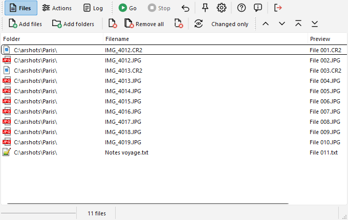
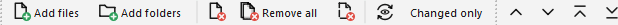

# Files page

This page displays the list of the files (and folders) that will be renamed.

The toolbar icons used to add and remove files from the list is always displayed, even when the Files page is not active.  

Here are the commands:

-  "Add files" button (F2) displays a standard file selection window where you can select the files to add, see [this page](addfiles_ta.md#addfiles) for additional details.
-  "Add folders" button (F3) displays a folder-selection window, that allows to add files and folders as described on [this page](addfiles_ta.md#addfolders).
-  "Remove selected files" button (F6) removes from the list the files that are selected. The files are not deleted from the disk.
-  "Remove all files" button (F7) clears the files list.
-  "Remove dead files" button (F8) removes from the list the files that do not exist anymore on the disk (missing files). That can happen if, for example, after renaming process you moved some files with the file manager.
-  "Refresh preview" button (F5) refreshes the contents of the "Preview" column (and displays it if it is not already visible). This preview is not automatic for performance purposes. It takes into account the planned actions (the [batch](batch_ta.md), or the action currently displayed if the batch is empty).
- "Changed only" button (next to it) hides, in the list, the files whose name does not change in the preview. It is only a view filter: the hidden files stay in the list and are renamed as usual. They are also deselected, so "Remove selected files" and the move buttons never touch them. Refresh the preview first, so there is something to compare. Handy to review the few files concerned in a large list, for example when replacing only the umlauts.

When you click with right mouse button on the headers of the list, a menu appears allowing to select which column has to be displayed or not from the following: Folder, Filename, Full path, Ext. (Extension), Preview, Size, Date created, Date modified. The headers can be resized and moved to change width and order of the columns. At least one column stays visible.

There are also four buttons allowing to move items within the list (up, down, to the top, to the bottom; Ctrl+Up, Ctrl+Down, Ctrl+Shift+Up, Ctrl+Shift+Down), to change the renaming order. You can also drag & drop items within the list to change their order.

This order can also be changed by sorting the files by clicking on column headers (click again to reverse the order). Sorting really changes the order of the list, so it is also the order in which the files are processed: it decides, for example, which file gets which number in an [Enumeration](actions_ta.md#enum). In Ant Renamer Qt, clicking on a column header sorts the text columns in natural order by default ("file 2" before "file 10"). The [options](options_ta.md#files) allow to get the alphabetical order of the original program instead. To disable the automatic sort, you can click with right mouse button on the headers of the list and select the "Unsorted items" command.

When you click with right mouse button on the list, a menu appears allowing to remove the selected files or all the files, to select all items of the list, to select none or to invert the selection, and to refresh the preview.

The icon of each file (based on its extension) can be displayed, and a double-click can open the file with the program associated with it: see the [options](options_ta.md#display).

Folders can be in the list too (see [adding files & folders](addfiles_ta.md)). They are renamed like files, in the order of the list; the files of the list that are inside a renamed folder follow it.

The number of files of the list is displayed at the bottom of the window.
