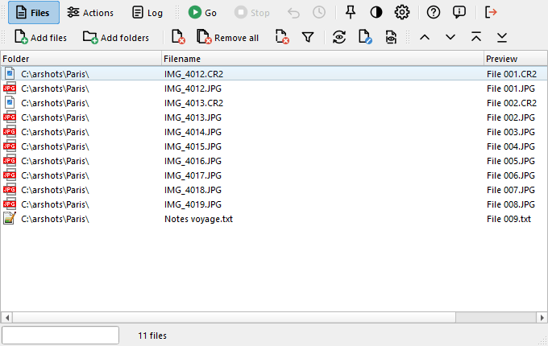
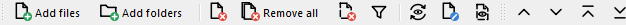
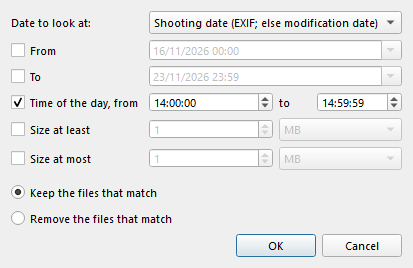
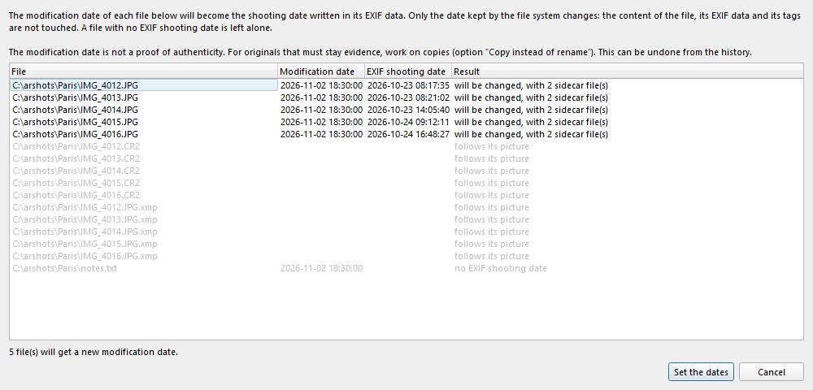

# Files page

This page displays the list of the files (and folders) that will be renamed.

The toolbar icons used to add and remove files from the list is always displayed, even when the Files page is not active.  

Here are the commands:

-  "Add files" button (F2) displays a standard file selection window where you can select the files to add, see [this page](addfiles_ta.md#addfiles) for additional details.
-  "Add folders" button (F3) displays a folder-selection window, that allows to add files and folders as described on [this page](addfiles_ta.md#addfolders).
-  "Remove selected files" button (F6) removes from the list the files that are selected. The files are not deleted from the disk.
-  "Remove all files" button (F7) clears the files list.
-  "Remove dead files" button (F8) removes from the list the files that do not exist anymore on the disk (missing files). That can happen if, for example, after renaming process you moved some files with the file manager.
-  "Filter files" button (F4) keeps, or removes, the files of the list that match a date, a time of the day or a size, see [below](#filter).
-  "Refresh preview" button (F5) refreshes the contents of the "Preview" column (and displays it if it is not already visible). This preview is not automatic for performance purposes. It takes into account the planned actions (the [batch](batch_ta.md), or the action currently displayed if the batch is empty).
- "Changed only" button (next to it) hides, in the list, the files whose name does not change in the preview. It is only a view filter: the hidden files stay in the list and are renamed as usual. They are also deselected, so "Remove selected files" and the move buttons never touch them. Refresh the preview first, so there is something to compare. Handy to review the few files concerned in a large list, for example when replacing only the umlauts.
- "Hidden files" button (next to it): shows or hides the hidden and system files of the list (`desktop.ini`, `.git`...). Off by default: they are hidden **and left alone by every operation** (not renamed, not counted by an enumeration). Switch it on to see them and process them; a warning is then shown before a renaming. Whether adding a folder puts them in the list at all is decided by Options > Files & Folders.

When you click with right mouse button on the headers of the list, a menu appears allowing to select which column has to be displayed or not from the following: Folder, Filename, Full path, Ext. (Extension), Preview, Size, Date created, Date modified. The headers can be resized and moved to change width and order of the columns. At least one column stays visible.

There are also four buttons allowing to move items within the list (up, down, to the top, to the bottom; Ctrl+Up, Ctrl+Down, Ctrl+Shift+Up, Ctrl+Shift+Down), to change the renaming order. You can also drag & drop items within the list to change their order.

This order can also be changed by sorting the files by clicking on column headers (click again to reverse the order). Sorting really changes the order of the list, so it is also the order in which the files are processed: it decides, for example, which file gets which number in an [Enumeration](actions_ta.md#enum). In Ant Renamer Qt, clicking on a column header sorts the text columns in natural order by default ("file 2" before "file 10"). The [options](options_ta.md#files) allow to get the alphabetical order of the original program instead. To disable the automatic sort, you can click with right mouse button on the headers of the list and select the "Unsorted items" command.

When you click with right mouse button on the list, a menu appears allowing to remove the selected files or all the files, to **filter the files** and to **set their dates from EXIF** (see below), to select all items of the list, to select none or to invert the selection, to refresh the preview, and to export it: "Export preview..." writes the files shown (the "Changed only" and "Hidden files" filters apply) to a CSV file (columns Folder, Name, New name; semicolon, UTF-8 with a BOM so that Excel and LibreOffice read the accents) or to a text file with the new names only, one per line. A file with no preview keeps its current name, so refresh the preview first.

The icon of each file (based on its extension) can be displayed, and a double-click can open the file with the program associated with it: see the [options](options_ta.md#display).

Folders can be in the list too (see [adding files & folders](addfiles_ta.md)). They are renamed like files, in the order of the list; the files of the list that are inside a renamed folder follow it.

The number of files of the list is displayed at the bottom of the window.

### Filter files {#filter}

*(Ant Renamer Qt)* The "Filter files..." button (F4, with a funnel) of the toolbar, also in the right-click menu, keeps, or removes, the files of the list that match what you tick: a period ("From", "To"), a time of the day ("Time of the day, from ... to ...", for example everything shot between 14:00 and 15:00 whatever the day; 22:00 to 02:00 works across midnight) and a size ("Size at least", "Size at most"). All the ticked criteria must hold together.

The date looked at is chosen above them: the modification date, the creation date (not kept by every Linux file system: a file without one never matches) or the shooting date (the EXIF date of a picture, else its modification date). The size limits are for files; a folder is judged on its dates.

The files are only taken out of the list: nothing is touched on the disk, and you can add them again. To correct a filter, press the button again: the last criteria are shown, and "Put back the files removed by the previous filter first" (ticked) restores the files the filter took out (each one right after the file that was before it, at the end if that file is gone) before the new filter is applied. While a filter hides files, the count at the bottom of the window turns orange ("12 files, 340 hidden by the filter") and the Filter button stays pressed. The "Clear the filter" button (or no criterion ticked, with the files put back) gives back every file that was taken out and filters nothing. "Remove all" forgets them.

### Set dates from EXIF {#setdates}

*(Ant Renamer Qt)* The right-click menu of the list has "Set dates from EXIF...". It gives the files, as their modification date, the shooting date written in their EXIF data (or in their XMP sidecar): useful for photos that were copied and whose date was overwritten. It is never automatic: a table shows the old and the new date of every file, and nothing changes before you press "Set the dates" ("Cancel" is the default button).

The table lists every file of the list with its modification date, its EXIF shooting date and what will happen: *will be changed* (with the number of sidecar files that follow it), *already right*, *no EXIF shooting date*, *follows its picture* (a sidecar file that is in the list too: its picture takes it along), *hidden file* (hidden files are left alone, as for a renaming) or *a folder has no EXIF date*.

Only the modification date kept by the file system changes. The content of the file, its EXIF data and its tags are not touched, and no date is typed by hand or invented: a file with no EXIF shooting date (or a date of 0000:00:00), a folder and a hidden file are left alone, and the log says why. The sidecar files (`.xmp`, `.dop`, the RAW of a JPEG, `IMG.DNG.xmp`...) follow their picture like in a renaming ([Options](options_en.md#processing), "Also rename the sidecar files"): they get the same date. A read-only file, or a file that another program keeps open, gets its date too. The log keeps the old and the new date, and the history (Undo) puts the old dates back, unless the file was changed since.

**The modification date is not a proof of authenticity.** For originals that must stay evidence, work on copies (option "Copy instead of rename"). On the command line, the parameter `--set-dates-from-exif` replaces the renaming, see [command-line parameters](params_en.md).
