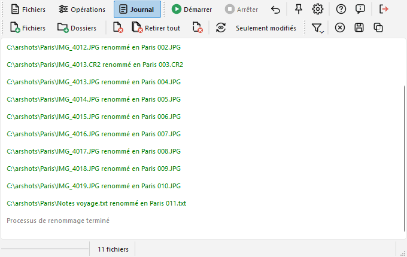
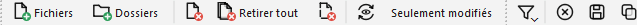

# Page "Journal"

Cette page est remplie avec le résultat du processus de renommage.

En plus de la barre d'outils Fichiers qui est toujours visible, une barre d'outils pour le journal est affichée :  

Voici ses commandes :

-  Le bouton "Filtrer" fera apparaître un menu permettant de spécifier quels types d'éléments vous voulez voir dans le journal : "Succès", "Erreurs" et "Non renommés" (voir paragraphe suivant). Le filtre ne fait que masquer des lignes, rien n'est perdu : cochez à nouveau l'entrée pour les revoir.
-  Le bouton "Vider" videra le journal.
-  Le bouton "Sauver..." ouvrira une fenêtre standard de sélection de fichier, vous permettant de choisir où sauver le contenu du journal.
-  Le bouton "Copier" copiera le contenu du journal dans le presse-papiers.

Lorsqu'un fichier est renommé avec succès, une ligne est ajoutée au journal, spécifiant l'ancien et le nouveau nom du fichier. Elle est écrite en vert. Si le fichier a changé de dossier, le nouveau chemin complet est affiché. Quand une image emmène ses fichiers annexes avec elle, la ligne les mentionne.

Dans le cas où le fichier n'a pas été renommé, soit un simple message (en bleu) ou une erreur (en rouge) est affiché.

Le premier cas est causé par un nouveau nom identique à l'ancien (pas besoin de renommer le fichier), par un fichier qui ne contient pas l'information dont l'opération a besoin (pas d'info ID3 pour l'opération mp3, pas d'info EXIF pour l'opération EXIF), par une ligne vide ou la fin de la liste dans l'opération "Noms à partir d'une liste", ou si le fichier source n'existe plus (par exemple si vous l'avez déplacé manuellement).

Les erreurs peuvent être causées par pas mal de choses. Par exemple, si le nouveau nom est déjà utilisé par un autre fichier, si le nom contient des caractères invalides ou si le fichier est bloqué par un programme. En général le message écrit est celui qui est retourné par le système d'exploitation.

Si vous cliquez sur "Annuler", les lignes du journal indiquent quels fichiers ont retrouvé leur ancien nom.

## Sauver automatiquement le journal dans un fichier {#save}

Cela peut être fait via l'option "Stocker le journal" de la [fenêtre des Options](options_fr.md#events), page "Événements".

Si cette option est activée, après le processus de renommage le contenu du journal sera stocké dans un fichier texte (encodé en UTF-8).

Ce fichier a deux colonnes (délimitées par un caractère de tabulation). La première contient un "v" pour une opération réussie et un "x" pour une erreur. La seconde contient le message.

Si l'option "Ajouter dans le fichier existant" est aussi activée, le fichier ne sera pas écrasé : les nouveaux éléments du journal seront ajoutés à la fin.

L'option "Générer un journal" de la [fenêtre des Options](options_fr.md#processing) peut être décochée pour ne pas remplir du tout le journal.
