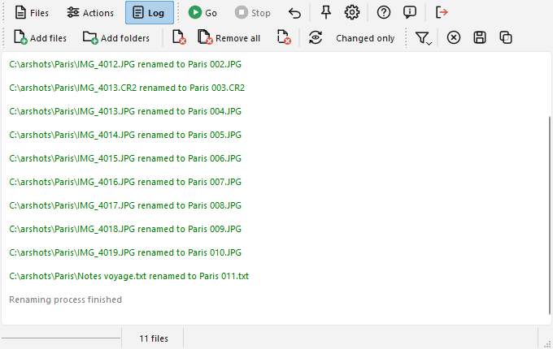

# Log page

This page is filled with the results of the renaming process.

In addition to the Files toolbar which is always visible, a toolbar for the log is displayed:  

Here are the commands:

-  "Filter" button will show a menu, which allows you to specify which kind of items you want to see in the log: "Successes", "Errors" and "Not renamed" (see next paragraph). The filter only hides lines, nothing is lost: tick the entry again to see them.
-  "Clear" button will empty the log.
-  "Save" button will open a standard file selection window, allowing you to choose where to save the log contents.
-  "Copy" button will copy the log contents to the clipboard.

When the renaming was fine, a line in the log is added specifying the old and new name of the file. It is written in green. If the file moved to another folder, the full new path is shown. When a picture takes its sidecar files along, the line mentions them.

In the case the file was not renamed, a message in blue is displayed. It is caused by an identical destination name (no need to rename the file), by a file that does not contain the information that the action needs (no ID3 info for the mp3 action, no EXIF info for the EXIF action), by an empty line or the end of the list in the "Take names from list" action, or when the source file does not exist anymore (e.g. you moved it manually). The message says which one.

When the system refuses the renaming, an error is displayed in red. The errors can be caused by lots of things. For example, if the new target name is already used by another file, if the name contains invalid characters or if the file is locked by a program. Usually the message written is the one that the operating system returns.

The messages of the program itself (start and end of a process, the list of the actions of the batch, "Operation stopped by user") are written in grey. They are always shown, whatever the filter.

If you click on "Undo", the lines of the log tell which files got their old name back.

## Automatically save log to file {#save}

This can be done with the "Save log to file" option from the [Options window](options_hr.md#events), "Events" page.

If the option is enabled, after the renaming operation the contents of the log will be stored in a text file (encoded in UTF-8).

This file has two columns (delimited by a tab character). The first one contains a "v" for successful operations, a "x" for errors and a space for the files that were not renamed. The second one contains the message. The grey messages of the program are not written. The lines end with CR+LF and a new file starts with a UTF-8 byte order mark.

If the "Append to current file" option is also enabled, the file will not be overwritten: new log entries will be added at the end. Only the entries of the run that has just ended are written, so several runs in a row do not repeat each other. If the file cannot be written, a red line in the log says so.

The "Generate log" option of the [Options window](options_hr.md#processing) can be unchecked to not fill the log at all.
