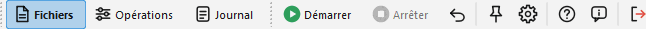

# Fenêtre principale

La fenêtre principale de Ant Renamer est divisée en trois pages :

- [Fichiers](files_fr.md) : Cette page contient la liste des fichiers qui seront renommés.
- [Opérations](actions_fr.md) : Cette page permet de choisir ce qui doit être fait avec les fichiers.
- [Journal](log_fr.md) : Cette page contient la liste de ce qui a été fait (ou n'a pas pu être fait) aux fichiers.

Ces pages sont accessibles via la barre d'outils "Pages" (ou avec Ctrl+1, Ctrl+2 et Ctrl+3) qui ressemble à ceci :  

Les icônes des boutons sont celles du set « Modern », par défaut depuis la version 3.0 (l'image des [options](options_fr.md#icons) le compare aux autres sets).

Avec la disposition moderne (voir plus bas), les boutons indiquent le nombre de fichiers de la liste et le nombre d'opérations planifiées, par exemple « Fichiers (100) » et « Opérations (2) ».

Une fois que vous avez défini les [fichiers à renommer](files_fr.md) et [comment les renommer](actions_fr.md), cliquez le bouton  "Démarrer" (F9). Le [journal](log_fr.md) indique ce qui est arrivé à chaque fichier. Le renommage s'exécute en arrière-plan : la fenêtre reste utilisable et la barre de progression en bas montre où il en est. Le bouton  "Arrêter" (Échap) l'interrompt ; les fichiers déjà traités restent renommés.

Le bouton  "Annuler" (F12) restaure les anciens noms. Il n'y a qu'un niveau d'annulation, donc vous ne pouvez annuler que la dernière opération effectuée. Les fichiers annexes renommés avec les images retrouvent eux aussi leur ancien nom.

Le bouton  "Avant-plan" (F11), lorsqu'il est actif, permet de conserver la fenêtre au-dessus des autres fenêtres lorsqu'elle n'est pas active.

Le bouton  "Options" (F10) ouvre la [fenêtre des options](options_fr.md).

Le bouton  "Aide" (F1) ouvre cette aide, et  "À propos" (Maj+F1) la fenêtre avec la version, les crédits et l'[historique des versions](history_fr.md).  "Quitter" (Alt+F4) ferme le programme.

La barre d'état, en bas de la fenêtre, indique la progression du renommage, le nombre de fichiers de la liste et le dernier message.

Dans Ant Renamer Qt, la fenêtre principale peut aussi être affichée avec une disposition moderne, avec les trois pages sur un seul écran si vous préférez, voir [disposition moderne de l'interface](modernui_fr.md).

## Raccourcis clavier {#shortcuts}

| Touche | Fonction | Touche | Fonction |
|---|---|---|---|
| F1 | Aide | F9 | Démarrer |
| Maj+F1 | À propos | Échap | Arrêter |
| F2 | Ajouter des fichiers | F10 | Options |
| F3 | Ajouter des dossiers | F11 | Avant-plan |
| F5 | Actualiser l'aperçu | F12 | Annuler |
| F6 | Retirer les fichiers sélectionnés | Alt+F4 | Quitter |
| F7 | Retirer tous les fichiers | Ctrl+1 / 2 / 3 | Page Fichiers / Opérations / Journal |
| F8 | Retirer les fichiers manquants | Ctrl+F2 | Ajouter l'opération au job |
| Ctrl+Haut / Ctrl+Bas | Monter / descendre | Maj+F6 | Retirer les opérations sélectionnées du job |
| Ctrl+Maj+Haut / Bas | Déplacer au début / à la fin | Maj+F7 | Vider le job |
| Ctrl+O | Ouvrir un job | Ctrl+S | Sauver le job |
