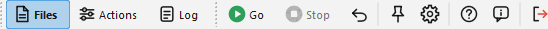

# Main window

The main window of Ant Renamer is divided in three pages:

- [Files](files_ta.md): This page contains the list of the files that will be renamed.
- [Actions](actions_ta.md): This page allows you to select what has to be done to the files.
- [Log](log_ta.md): This page contains the list of what has been done (or failed to be done) to the files.

These pages can be accessed through the "Pages" toolbar (or with Ctrl+1, Ctrl+2 and Ctrl+3) which looks like this:  

The icons of the buttons are those of the "Modern" set, the default since version 3.0 (the picture of the [options](options_ta.md#icons) compares it with the other sets).

The buttons show the number of files in the list and the number of planned actions, for example "Files (100)" and "Actions (2)", when the modern layout is used (see below).

Once you defined the [files to rename](files_ta.md) and [how to rename them](actions_ta.md), click the  "Go" button (F9). The [log](log_ta.md) indicates you what happened to each file. The renaming runs in the background: the window stays usable, the progress bar at the bottom shows how far it is, and the buttons that would modify the list, the batch or the options (add or remove files, move, batch commands, Options, Undo...) are disabled until it ends. The  "Stop" button (Esc) interrupts it; the files already processed stay renamed.

The  "Undo" button (F12) reverts to the old names. It only has one level of undo, so you can only undo the last change that has been made. The sidecar files renamed with the pictures get their old names back too.

The  "Always on top" button (F11), when checked, allows to keep the window always on top of other windows when it is not active.

The "Light / dark" button (half-filled circle, next to "Always on top") switches at once between the light and the dark theme. The choice is kept; "Follow the system" can be set back in the [Options](options_ta.md#display).

The  "Options" button (F10) opens the [options window](options_ta.md).

The  "Help" button (F1) opens this help, and  "About" (Shift+F1) the window with the version, the credits and the [history of the versions](history_ta.md).  "Exit" (Alt+F4) quits the program.

The status bar, at the bottom of the window, shows the progress of the renaming, the number of files in the list and the last message.

In Ant Renamer Qt the main window can also be shown with a modern layout, with the three pages on one screen if you prefer, see [modern interface layout](modernui_ta.md).

## Keyboard shortcuts {#shortcuts}

| Key | Function | Key | Function |
|---|---|---|---|
| F1 | Help | F9 | Go |
| Shift+F1 | About | Esc | Stop |
| F2 | Add files | F10 | Options |
| F3 | Add folders | F11 | Always on top |
| F5 | Refresh preview | F12 | Undo |
| F6 | Remove selected files | Alt+F4 | Exit |
| F7 | Remove all files | Ctrl+1 / 2 / 3 | Files / Actions / Log page |
| F8 | Remove dead files | Ctrl+F2 | Add action to batch |
| Ctrl+Up / Ctrl+Down | Move up / down | Shift+F6 | Remove selected actions of the batch |
| Ctrl+Shift+Up / Down | Move to top / bottom | Shift+F7 | Clear the batch |
| Ctrl+O | Open a batch | Ctrl+S | Save the batch |
