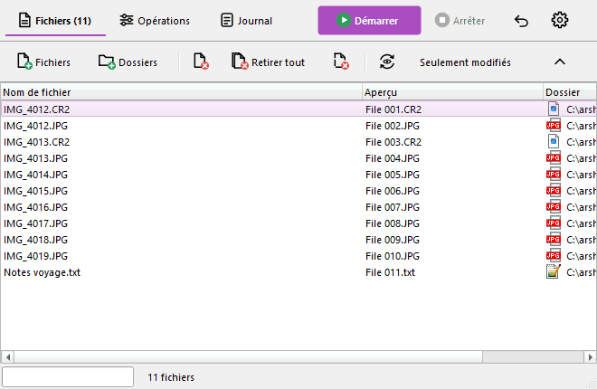
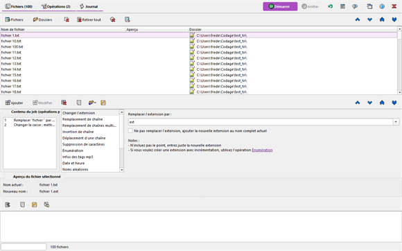
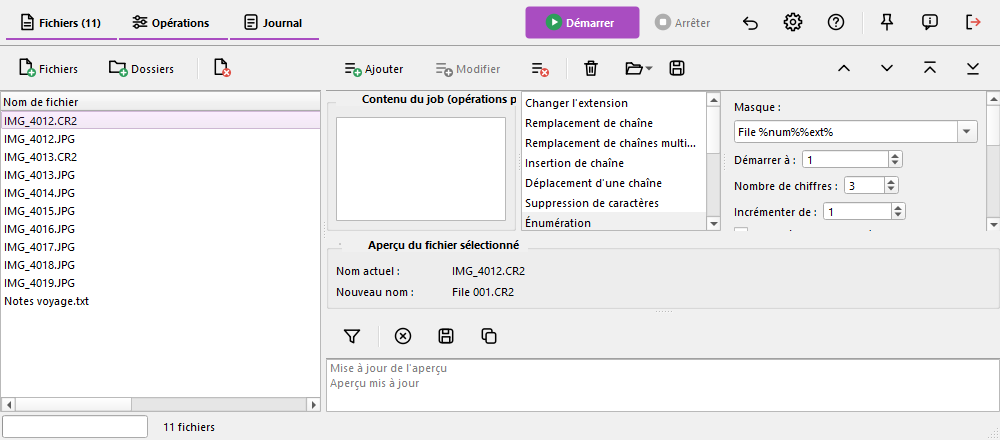

# Disposition moderne de l'interface

Ce chapitre est propre à Ant Renamer Qt. En plus de la disposition classique décrite dans le reste de cette aide, le programme peut afficher sa fenêtre principale avec une disposition moderne : les mêmes fonctions et le même moteur de renommage, avec une autre présentation. La disposition classique reste celle par défaut.

## L'activer {#enable}

Ouvrez la [fenêtre des options](options_fr.md#display), page *Affichage* :

- **Disposition moderne de l'interface** : affiche la disposition moderne à la place de la classique.
- **Disposition des pages (interface moderne)** : la façon dont les trois pages (Fichiers, Opérations, Journal) sont arrangées : *Onglets*, *Écran unique, en bandes* ou *Écran unique, en colonnes*, voir [ci-dessous](#layouts). Ce choix n'est disponible que si la disposition moderne est activée.

Les changements sont pris en compte dès que vous cliquez sur "OK" dans les options : la fenêtre est reconstruite, et vos fichiers, votre batch et votre journal sont conservés. La disposition moderne garde sa propre taille de fenêtre, ses largeurs de colonnes et la position de ses séparateurs : la disposition classique n'est pas affectée, vous pouvez y revenir à tout moment.

## Barre principale et barres des pages {#bar}

La barre principale, en haut de la fenêtre, contient les trois boutons de pages (*Fichiers*, *Opérations*, *Journal*), qui indiquent le nombre de fichiers de la liste et le nombre d'opérations planifiées, par exemple « Fichiers (100) » et « Opérations (2) ». À droite se trouvent le bouton *Démarrer* (le seul en couleur), *Arrêter*, *Annuler*, *Historique*, *Options*, *Aide*, *Toujours au premier plan*, *À propos* et *Quitter*.

Les autres boutons ne sont plus dans la barre principale : chaque page a sa propre barre d'outils fine, en haut de la page (ajout et retrait de fichiers pour la page Fichiers, les commandes du job pour la page Opérations, le filtre et les commandes du journal pour la page Journal). Les boutons qui déplacent les éléments sont à droite des barres des pages Fichiers et Opérations. Les barres d'outils de la disposition moderne ne sont pas déplaçables. Les raccourcis clavier sont les mêmes que dans la disposition classique.

## Disposition des pages {#layouts}

### Onglets

Une page à la fois, comme dans la disposition classique, avec le nouveau style.

### Écran unique, en bandes

Les trois pages sont affichées ensemble, les unes au-dessus des autres : les fichiers en haut, les opérations au milieu, le journal en bas.

### Écran unique, en colonnes

Les fichiers à gauche, les opérations à droite au-dessus du journal. Cette disposition convient aux écrans larges.

Dans les deux dispositions en écran unique :

- Les volets sont séparés par des séparateurs que vous pouvez faire glisser. Chaque volet a une taille minimale. Les tailles, et les volets que vous avez masqués, sont mémorisés pour chaque disposition.
- Les boutons de pages de la barre principale (et Ctrl+1, Ctrl+2, Ctrl+3) affichent ou masquent un volet au lieu de changer de page. Les actions qui ont besoin d'afficher une page, comme le journal au début du renommage, s'assurent que son volet est visible.
- Les boutons qui déplacent les éléments (haut, bas, début, fin) agissent sur la liste qui a le focus du clavier : la liste des fichiers ou la liste du job.
- La disposition en colonnes demande de la place : quand la fenêtre est plus étroite qu'environ 900 pixels, le programme passe en bandes, et revient aux colonnes quand la fenêtre est de nouveau assez large (environ 960 pixels).

## La page Fichiers {#files}

La liste affiche le nom actuel, le nouveau nom (colonne *Aperçu*) et le dossier. La colonne *Aperçu* est visible par défaut ; comme dans la disposition classique, elle est remplie par le bouton  « Actualiser l'aperçu » (F5). Les colonnes peuvent toujours être affichées, masquées, déplacées et redimensionnées depuis le menu des en-têtes.

## Modifier une opération du job {#edit}

Dans la disposition classique, une opération ne peut plus être modifiée après avoir été ajoutée au [job](batch_fr.md). Dans la disposition moderne, c'est possible, pour tous les types d'opérations :

1. Double-cliquez sur l'opération dans la liste « Contenu du job ». Son type et ses paramètres sont chargés dans l'éditeur, et la barre « Modification de l'action N » apparaît sous l'éditeur.
2. Changez les paramètres.
3. Cliquez sur *Valider la modification* (ou sur le bouton *Modifier* de la barre d'outils des opérations) pour remplacer l'opération. Elle garde sa position dans le job. Cliquez sur *Annuler la modification* pour oublier les changements.

Le bouton *Modifier* fonctionne aussi sans le double-clic : il remplace l'opération sélectionnée de la liste par les réglages qui sont actuellement dans l'éditeur. La barre de modification disparaît d'elle-même si l'opération est retirée ou déplacée entre-temps.

## Autres différences avec la disposition classique {#diff}

- La liste « Contenu du job » est toujours visible à côté de l'éditeur, et la bande « Aperçu du fichier sélectionné » est toujours affichée.
- Le texte des boutons et les raccourcis sont les mêmes ; seule leur place change.
- Le style suit les couleurs de votre système (thème clair ou sombre).
