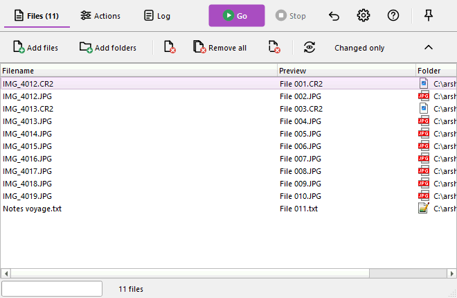
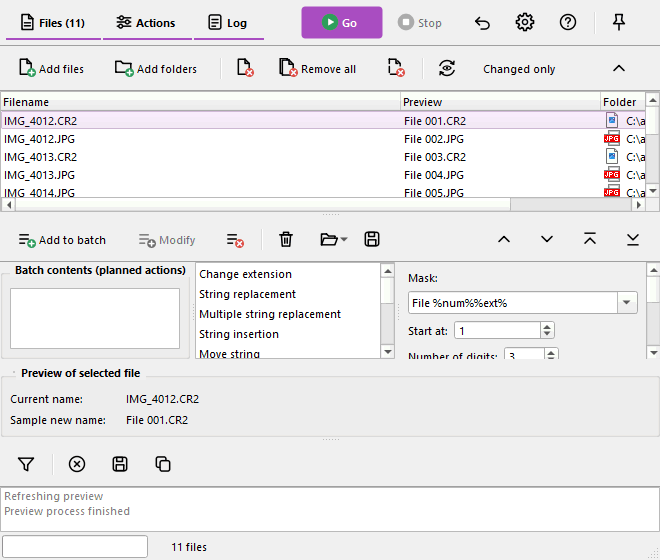
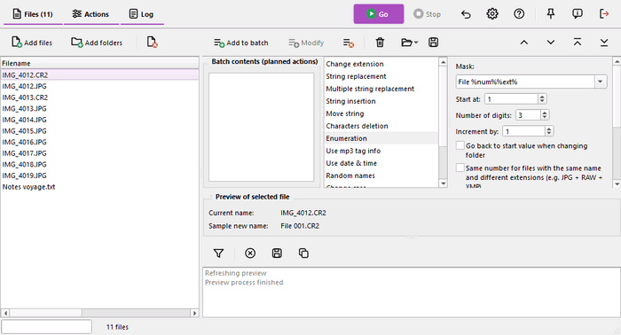

# Modern interface layout

This chapter is specific to Ant Renamer Qt. In addition to the classic layout described in the rest of this help, the program can show its main window with a modern layout: the same functions and the same renaming engine, with another presentation. The classic layout stays the default one.

## Enabling it {#enable}

Open the [options window](options_hr.md#display), *Display* page:

- **Modern interface layout (used at the next start)** : shows the modern layout instead of the classic one.
- **Pages layout (modern interface)** : how the three pages (Files, Actions, Log) are arranged: *Tabs*, *Single screen, in bands* or *Single screen, in columns*, see [below](#layouts). This choice is only available when the modern layout is enabled.

The changes are applied the next time the program starts. The modern layout keeps its own window size, column widths and splitter positions, so the classic layout is not affected: you can go back to it at any time.

## Main bar and page bars {#bar}

The main bar at the top of the window contains the three pages buttons (*Files*, *Actions*, *Log*), which show how many files are in the list and how many actions are planned, for example "Files (100)" and "Actions (2)". On the right are the *Go* button (the only coloured one), *Stop*, *Undo*, *Options*, *Help*, *Always on top*, *About* and *Exit*.

The other buttons are not in the main bar any more: each page has its own slim toolbar at the top of the page (add and remove files for the Files page, the batch commands for the Actions page, the filter and the log commands for the Log page). The buttons that move items are at the right of the Files and Actions toolbars. The toolbars of the modern layout cannot be moved. Keyboard shortcuts are the same as in the classic layout.

## Pages layout {#layouts}

### Tabs

One page at a time, like the classic layout, with the new look.

### Single screen, in bands

The three pages are shown together, one above the other: files on top, actions in the middle, log at the bottom.

### Single screen, in columns

Files on the left, actions on the right above the log. This arrangement suits wide screens.

In both single screen arrangements:

- The panes are separated by splitters that you can drag. Each pane has a minimum size. The sizes, and the panes you hid, are remembered for each arrangement.
- The page buttons of the main bar (and Ctrl+1, Ctrl+2, Ctrl+3) show or hide a pane instead of changing page. Actions that need to show a page, such as the log when the renaming starts, make sure its pane is visible.
- The buttons that move items (up, down, first, last) act on the list that has the keyboard focus: the Files list or the batch list.
- The columns arrangement needs room: when the window is narrower than about 900 pixels, the program switches to bands, and comes back to columns when the window is wide enough again (about 960 pixels).

## The Files page {#files}

The list shows the current name, the new name (*Preview* column) and the folder. The *Preview* column is visible by default; as in the classic layout it is filled with the  "Refresh preview" button (F5). Columns can still be shown, hidden, moved and resized from the menu of the headers.

## Editing an action of the batch {#edit}

In the classic layout an action cannot be modified once it has been added to the [batch](batch_hr.md). In the modern layout it can, for every type of action:

1. Double-click the action in the "Batch contents" list. Its type and its parameters are loaded in the editor, and the bar "Modification of action N" appears under the editor.
2. Change the parameters.
3. Click *Validate the modification* (or the *Modify* button of the Actions toolbar) to replace the action. It keeps its position in the batch. Click *Cancel the modification* to forget the changes.

The *Modify* button also works without the double-click: it replaces the selected action of the list with the settings that are currently in the editor. The bar of the modification disappears by itself if the action is removed or moved meanwhile.

## Other differences with the classic layout {#diff}

- The "Batch contents" list is always visible next to the editor, and the "Preview of selected file" strip is always shown.
- The text of the buttons and the shortcuts are the same; only their place changes.
- The look follows the colours of your system (light or dark theme).
