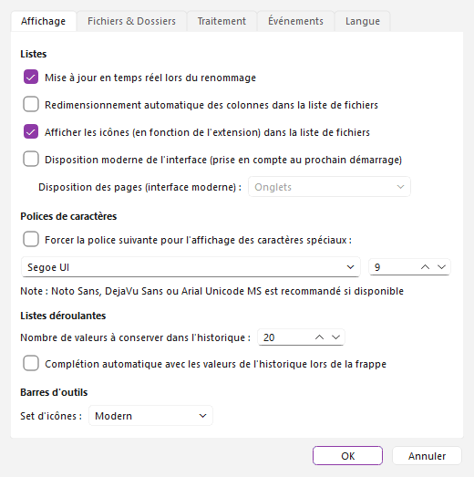
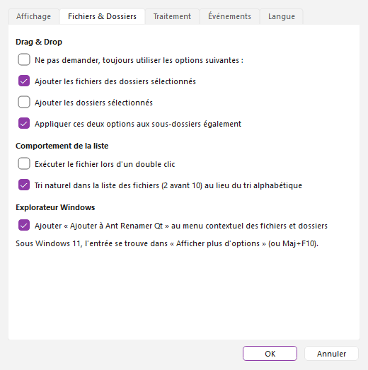
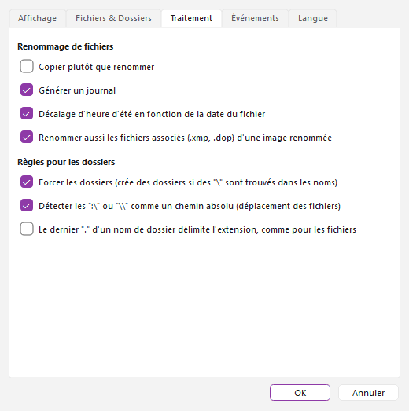
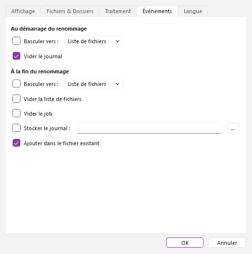
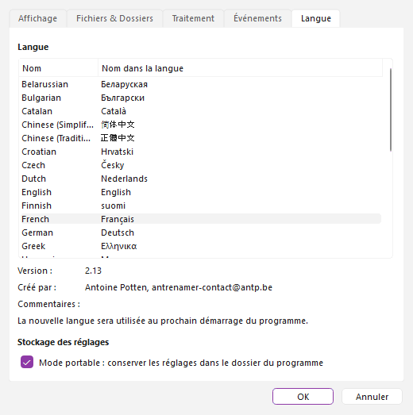

# Fenêtre des options

Cette fenêtre est accessible via l'icône  "Options" (F10) de la fenêtre principale. Elle est divisée en cinq pages. Les changements sont appliqués quand vous cliquez sur "OK" (et perdus si vous cliquez sur "Annuler") ; quelques-uns ne sont pris en compte qu'au prochain démarrage du programme, comme indiqué plus bas.

## Affichage {#display}

- **Mise à jour en temps réel lors du renommage** : Le contenu des listes est mis à jour à chaque fois qu'un fichier est renommé. Ça peut être un peu lent si vous renommez des milliers de fichiers ou sur une machine lente.
- **Redimensionnement automatique des colonnes de la liste de fichiers** : Lorsque cette option est activée, le programme va toujours essayer de faire rentrer les colonnes de la liste des Fichiers (fenêtre principale) dans la largeur de la fenêtre.
- **Afficher les icônes (en fonction de l'extension) dans la liste de fichiers** : Affiche les icônes à gauche des éléments de la liste des Fichiers. Cela peut ralentir un peu le défilement de la liste, et comme chaque fichier ".exe" a sa propre icône cela peut être assez lent pour les fichiers provenant d'un disque réseau par exemple.
- **Disposition moderne de l'interface (prise en compte au prochain démarrage)** : (Ant Renamer Qt) Affiche la disposition moderne de la fenêtre principale à la place de la classique. Voir [disposition moderne de l'interface](modernui_fr.md).
- **Disposition des pages (interface moderne)** : (Ant Renamer Qt) Disponible seulement avec la disposition moderne : *Onglets*, *Écran unique, en bandes* ou *Écran unique, en colonnes*. Pris en compte au prochain démarrage. Voir [disposition des pages](modernui_fr.md#layouts).
- **Forcer la police suivante pour l'affichage des caractères spéciaux** : Remplace la police du programme par la police et la taille choisies en dessous. Utile si certains caractères (langues asiatiques, symboles) s'affichent sous forme de carrés : [cliquez ici pour plus d'informations](fonts_fr.md). Par défaut la police de votre système est utilisée.
- **Nombre de valeurs à conserver dans l'historique** : Les listes déroulantes des opérations retiennent les dernières chaînes de caractères que vous avez utilisées. Vous pouvez choisir ici combien doivent être conservées (1 à 200).
- **Complétion automatique avec les valeurs de l'historique lors de la frappe** : Lorsque vous tapez le texte, s'il a le même début qu'un élément existant dans l'historique, cet élément sera copié dans le champ (la partie que vous n'avez pas tapée sera sélectionnée, de manière à ce que vous puissiez continuer à taper pour l'écraser).
- **Thème** : (Ant Renamer Qt) « Suivre le système » (par défaut), « Clair » ou « Sombre ». Clair et sombre ont le même aspect sur tous les systèmes ; c'est utile là où le thème du système n'est pas détecté (une AppImage, par exemple). Le bouton « Clair / sombre » de la barre d'outils le change aussi.
- **Rechercher une nouvelle version au démarrage** : (Ant Renamer Qt) Désactivé par défaut. Quand il est activé, le programme interroge GitHub une fois par jour, quelques secondes après le démarrage, pour obtenir la liste des versions publiées, et propose d'ouvrir la page de téléchargement s'il en existe une plus récente (une version finale n'est pas prévenue des versions candidates). Rien d'autre n'est envoyé : ni nom de fichier, ni réglage, seulement une requête web ordinaire qui indique le nom et la version du programme. Le bouton « Rechercher une mise à jour » de la [fenêtre À propos](about_fr.md) fait la même chose à la demande. Si GitHub est inaccessible (pas de réseau, pare-feu, panne de GitHub), il ne se passe rien : aucun message au démarrage, aucun ralentissement, et le programme fonctionne comme d'habitude ; la recherche sera simplement retentée au démarrage suivant.
- **Set d'icônes** : Jeu d'icônes à utiliser pour les barres d'outils. Quatre sets sont inclus : "Scrows", "Windows XP", "Windows XP Large" (le même que le précédent, mais avec des icônes plus grandes) et "Modern" (Ant Renamer Qt, par défaut) : des icônes au trait dessinées par le programme, nettes sur les écrans à haute résolution, qui suivent le thème clair ou sombre de votre système. Le set est appliqué immédiatement.

### Les icônes des barres d'outils {#icons}

La liste « Set d'icônes » propose quatre sets : « Scrows », « Windows XP », « Windows XP Large » et « Modern ». « Modern » est le set par défaut depuis la version 3.0. L'image ci-dessous montre les quatre sets : chaque colonne est un bouton, chaque ligne un set, dans l'ordre de la liste (les icônes sont dessinées ici à la même taille pour les comparer ; « Windows XP Large » est plus grand dans le programme). Les images de cette aide montrent le set Modern.

## Fichiers & Dossiers {#files}

- **Ne pas demander, toujours utiliser les options suivantes** : Empêche l'affichage d'une fenêtre à chaque fois que vous déposez des fichiers sur la fenêtre d'Ant Renamer. Vous pouvez spécifier ici les options plutôt que d'avoir à les choisir à chaque fois (ajouter les fichiers des dossiers, ajouter les dossiers, appliquer aux sous-dossiers). Ces options sont détaillées dans le chapitre "[Ajout de fichiers & dossiers](addfiles_fr.md#dragdrop)".
- **Tri naturel dans la liste des fichiers (2 avant 10) au lieu du tri alphabétique** : Si cette option est activée (par défaut), le tri de la liste des fichiers par un clic sur un en-tête de colonne classe les nombres contenus dans les noms selon leur valeur (« fichier 2 » avant « fichier 10 »). Sinon l'ordre est alphabétique (« fichier 10 » avant « fichier 2 »).
- **Exécuter le fichier lors d'un double clic** : Si cette option est activée, lorsque vous double-cliquez sur un fichier de la liste des Fichiers il sera ouvert comme si vous aviez double-cliqué dessus dans le gestionnaire de fichiers.
- **Le bouton Annuler** : annule la dernière passe (par défaut) ou ouvre l'[historique](main_fr.md) des passes, où vous choisissez jusqu'où revenir en arrière. Le bouton Historique (Maj+F12) ouvre toujours l'historique.
- **Inclure les fichiers cachés et système à l'ajout d'un dossier** : Si cette option est activée, l'ajout d'un dossier ajoute aussi ses fichiers cachés et système (`desktop.ini`, `.git`...). Elle est désactivée par défaut. Les fichiers choisis ou déposés un par un sont toujours ajoutés. Un avertissement s'affiche avant un renommage si la liste contient des fichiers cachés ou système.
- **Ajouter « Ajouter à Ant Renamer Qt » au menu contextuel des fichiers et dossiers** : (Windows uniquement) Ajoute ou retire l'entrée du menu contextuel de l'Explorateur Windows, voir [ajout de fichiers & dossiers](addfiles_fr.md#explorer). Sous Windows 11, l'entrée est dans « Afficher plus d'options » (ou Maj+F10).

## Traitement {#processing}

- **Copier plutôt que renommer** : Bien que le programme ait été prévu pour renommer des fichiers, il peut parfois être utile de copier les fichiers sous un autre nom plutôt que de les renommer. Les fichiers d'origine restent où ils sont.
- **Générer un journal** : Si l'option est désactivée, la page "Journal" de la fenêtre principale ne sera pas remplie avec tous les fichiers traités.
- **Décalage d'heure d'été en fonction de la date du fichier** : Si activé (par défaut), le décalage pour l'heure d'été est calculé en fonction de la date du fichier, sinon il est calculé en fonction de la date actuelle (comportement des anciennes versions de Windows). Cela joue sur les dates utilisées par l'opération [Date et heure](actions_fr.md#datetime).
- **Renommer aussi les fichiers associés (.xmp, .dop) d'une image renommée** : (Ant Renamer Qt) Activé par défaut. Quand une image est renommée, ses fichiers associés sont renommés avec elle : fichiers XMP (`IMG.xmp`, écrit par Lightroom ou Capture One, ou `IMG.CR2.xmp`, écrit par digiKam ou darktable) et fichiers DxO PhotoLab (`IMG.dop` ou `IMG.CR2.dop`) ; aussi avec une extension en majuscules. Ils reprennent leur ancien nom si vous annulez. S'il existe déjà un fichier portant le nouveau nom du fichier associé, celui-ci n'est pas touché et la ligne du journal le signale. Un fichier associé qui est lui-même dans la liste des Fichiers est renommé une seule fois, avec son image. Sans effet en mode « Copier plutôt que renommer », ni pour les dossiers.
- **Forcer les dossiers (crée des dossiers si des "\\" sont trouvés dans les noms)** : Un caractère "\\" n'est pas valide dans un nom de fichier puisqu'il est utilisé comme délimiteur de dossiers (par exemple c:\\Program Files\\Ant Renamer\\Renamer.exe). Donc lorsqu'un "\\" est trouvé dans un nom de fichier la partie avant le "\\" est considérée comme un dossier. Pour pouvoir déplacer le fichier vers ce dossier, il doit exister. Si cette option est activée, avant de renommer/déplacer chaque fichier le programme vérifiera si le dossier existe, et le créera si ce n'est pas le cas. Sous Linux, utilisez "/" comme délimiteur.
- **Détecter les ":\\" ou "\\\\" comme chemins absolus** : Lorsque cette option est activée, si le nouveau nom de fichier commence par "x:\\" (x = n'importe quelle lettre) ou par "\\\\", alors l'ancien chemin ne sera pas ajouté en début de nom. Cela permet de déplacer les fichiers n'importe où en donnant le chemin complet comme nouveau nom de fichier. Sous Linux, un nouveau nom qui commence par "/" est un chemin absolu.
- **Le dernier "." d'un nom de dossier délimite l'extension, comme pour les fichiers** : Par défaut cette option est désactivée, car la plupart du temps dans les environnements modernes les dossiers n'ont pas d'extension comme l'ont les fichiers ; dans ce cas, les noms de dossiers sont traités comme des fichiers sans extension. Si l'option est activée, tout ce qui suit le dernier point dans un nom de dossier sera considéré comme une extension, comme cela est fait sur les fichiers. Cela affecte le comportement des options "Inclure l'extension" et "Appliquer à l'extension plutôt qu'au nom" de plusieurs opérations, ainsi que de `%ext%`.

## Événements {#events}

- **Au démarrage du renommage** : Permet de définir quoi faire avant de commencer à renommer les fichiers, lorsque vous cliquez le bouton "Démarrer" : "Basculer vers :" une page (Liste de fichiers, Opérations ou Journal) et "Vider le journal".
- **À la fin du renommage** : Permet de définir quoi faire lorsque le traitement est terminé : "Basculer vers :" une page, "Vider la liste de fichiers" et "Vider le job" (les vider), et "Stocker le journal" pour conserver le contenu du journal dans un fichier (le bouton "Parcourir..." choisit le fichier). Consultez la rubrique de la [page "Journal"](log_fr.md#save) pour plus d'informations, y compris l'option "Ajouter dans le fichier existant".

## Langue {#languages}

- Dans cette page vous pouvez sélectionner la langue à utiliser pour l'interface utilisateur. La liste montre les fichiers de langue (le dossier "Languages" du programme) ; le nom du traducteur et la version du fichier sont affichés sous la liste. La nouvelle langue est utilisée au prochain démarrage du programme.
- L'aide existe en anglais, français, croate et tamoul. Pour les autres langues de l'interface, l'aide est affichée en anglais.
- **Mode portable : conserver les réglages dans le dossier du programme** : Par défaut les réglages sont stockés dans votre profil utilisateur (`%APPDATA%` sous Windows, `~/.local/share/AntRenamerQt` sous Linux). Avec cette option ils sont stockés dans un fichier `antrenamer-qt.ini` à côté du programme, ce qui permet d'emporter le programme et ses réglages sur une clé USB. Décocher l'option les remet dans votre profil. Le fichier peut aussi être créé à la main (un fichier vide suffit).
