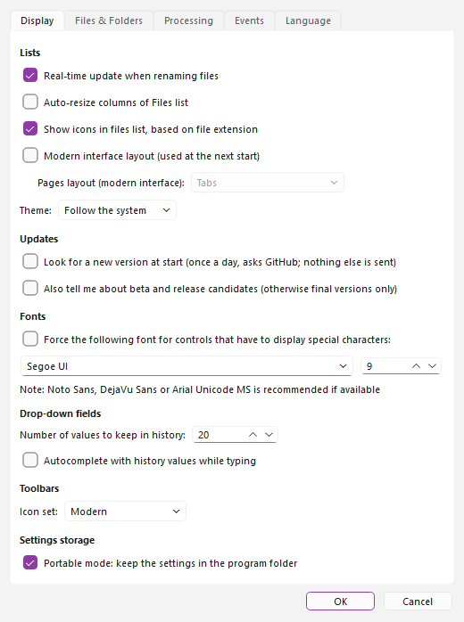
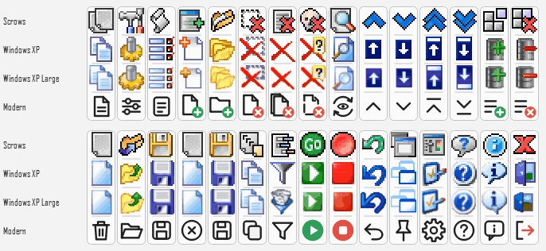
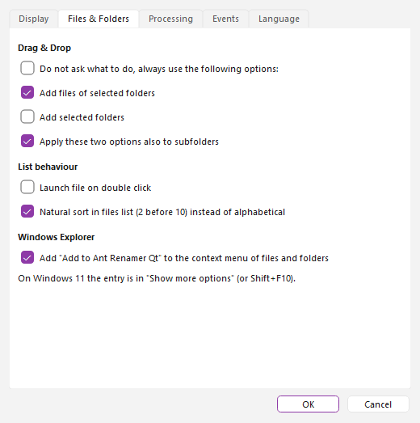
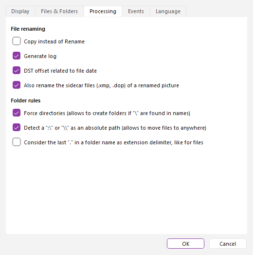
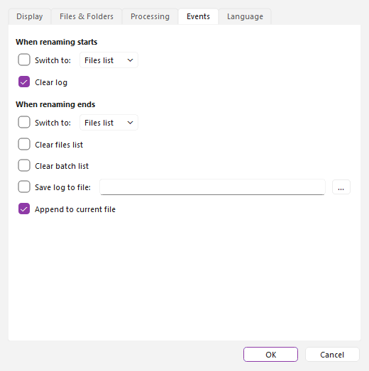
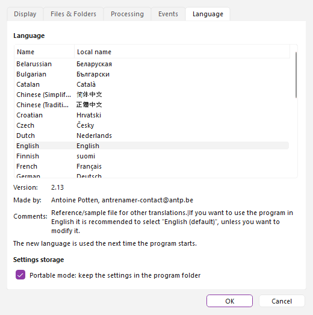

# Options window

This window is accessible through the  "Options" icon (F10) of the main window. It is divided in five pages. The changes are applied when you click "OK" (and are lost if you click "Cancel"); a few of them are only used the next time the program starts, as noted below.

## Display {#display}

- **Real-time update when renaming files** : The lists contents are updated each time a file is renamed. It is quite slower if you rename thousands of files or on a slow machine.
- **Auto-resize columns of Files list** : When enabled, the program will always try to fit the columns of Files list (main window) in the width of the window.
- **Show icons in files list, based on file extension** : Displays icons on the left of the items of the Files list. It may slow down a little the scrolling of the list, and since each ".exe" file has its own icon it may be quite slow for files coming from a network drive for example.
- **Modern interface layout (used at the next start)** : (Ant Renamer Qt) Shows the modern layout of the main window instead of the classic one. See [modern interface layout](modernui_ta.md).
- **Pages layout (modern interface)** : (Ant Renamer Qt) Only available with the modern layout: *Tabs*, *Single screen, in bands* or *Single screen, in columns*. Used the next time the program starts. See [pages layout](modernui_ta.md#layouts).
- **Force the following font for controls that have to display special characters** : Replaces the font of the program by the font and the size chosen below it. Useful if some characters (Asian languages, symbols) are displayed as squares: [click here for more information](fonts_ta.md). By default the font of your system is used.
- **Number of values to keep in history** : The drop-down lists of the actions remember the last text strings that you used. You can specify here how much strings have to be kept (1 to 200).
- **Autocomplete with history values while typing** : When you type the text, if it has the same beginning than an existing item of the history this item will be copied in the field (the part you did not type is selected, so you can continue to type to overwrite it).
- **Theme** : (Ant Renamer Qt) "Follow the system" (default), "Light" or "Dark". Light and dark use the same look on every system; this is useful where the system theme is not detected (an AppImage, for instance). The "Light / dark" button of the toolbar changes it too.
- **Icon set** : Icon set to use for toolbars. Four sets are included: "Scrows", "Windows XP", "Windows XP Large" (the same as the second one, with larger icons) and "Modern" (Ant Renamer Qt, the default): line icons drawn by the program, sharp on high-resolution screens, which follow the light or dark theme of your system. The set is applied immediately.

### The toolbar icons {#icons}

The "Icon set" list offers four sets: "Scrows", "Windows XP", "Windows XP Large" and "Modern". "Modern" is the default since version 3.0. The picture below shows the four sets: each column is one button, each row is one set, in the order of the list (the icons are drawn at the same size here to compare them; "Windows XP Large" is bigger in the program). The pictures of this help show the Modern set.

## Files & Folders {#files}

- **Do not ask what to do, always use the following options** : Prevents from displaying a window each time you drag & drop files to Ant Renamer window. You can specify here the options instead of having to select them each time (add the files of the folders, add the folders, apply to subfolders). These options are detailed in the chapter "[Adding files & folders](addfiles_ta.md#dragdrop)".
- **Natural sort in files list (2 before 10) instead of alphabetical** : If this option is enabled (default), sorting the Files list by clicking on a column header orders numbers inside names by value ("file 2" before "file 10"). Otherwise the order is alphabetical ("file 10" before "file 2").
- **Launch file on double click** : If this option is enabled, when you double-click on a file from the Files list it will be opened like if you double-clicked it in the file manager.
- **Add "Add to Ant Renamer Qt" to the context menu of files and folders** : (Windows only) Adds or removes the entry of the context menu of Windows Explorer, see [adding files & folders](addfiles_ta.md#explorer). On Windows 11 the entry is in "Show more options" (or Shift+F10).

## Processing {#processing}

- **Copy instead of Rename** : Though the program is designed for renaming file, it can sometimes be useful to copy the files to a new name instead of rename them. The original files stay where they are.
- **Generate log** : If this is disabled, the Log page of the main window will not be filled with all the files processed.
- **DST offset related to file date** : If enabled (default), the offset for daylight saving time is computed from the file date, otherwise it is computed from current date (the behaviour of old versions of Windows). It matters for the dates used by the [date & time](actions_ta.md#datetime) action.
- **Also rename the sidecar files (.xmp, .dop) of a renamed picture** : (Ant Renamer Qt) Enabled by default. When a picture is renamed, its sidecar files are renamed with it: XMP files (`IMG.xmp`, written by Lightroom or Capture One, or `IMG.CR2.xmp`, written by digiKam or darktable) and DxO PhotoLab files (`IMG.dop` or `IMG.CR2.dop`); also with an upper-case extension. They go back to their old names if you revert. If a file with the new sidecar name already exists, the sidecar is left alone and the log line says so. A sidecar that is itself in the Files list is renamed once, with its picture. Not used in "Copy instead of Rename" mode, nor for folders.
- **Force directories (allows to create folders if "\\" are found in names)** : A "\\" character is not valid in a file name since it is used as path delimiter (e.g. c:\\Program Files\\Ant Renamer\\Renamer.exe). So when a "\\" is found in a file name the part before the "\\" is considered as a folder. To be able to move the file to this folder, it must exist. If this option is checked, before renaming/moving each file the program will check that the folder exists, and will create it if it is not found. On Linux, use "/" as the delimiter.
- **Detect a ":\\" or "\\\\" as an absolute path** : When this option is enabled, if the new file name begins by "x:\\" (x = any letter) or by "\\\\", then the old path will not be added in front on it. This allows to move the files anywhere by giving the full path as new file name. On Linux, a new name that begins with "/" is an absolute path.
- **Consider the last "." in a folder name as extension delimiter, like for files** : By default this option is disabled, as usually in modern environments the folders do not have extensions like files do; in such case, the folder names are treated like files that do not have an extension. If the option is enabled, all what follows the last dot in a folder name will be considered as an extension, as it is done on files. This affects the behaviour of the options "Include extension" and "Apply to extension instead of name" in several actions, and of `%ext%`.

## Events {#events}

- **When renaming starts** : Allows to define what to do before starting to rename files, when you click the "Go" button: "Switch to:" a page (Files list, Actions or Log) and "Clear log".
- **When renaming ends** : Allows to define what to do when renaming process is complete: "Switch to:" a page, "Clear files list" and "Clear batch list" (empty them), and "Save log to file" to store the log contents in a file (the "..." button chooses the file). See "[Log page](log_ta.md#save)" for more information, including the "Append to current file" option.

## Language {#languages}

- In this page you can select the language to use in the user interface. The list shows the language files (the folder "Languages" of the program); the name of the translator and the version of the file are displayed under the list. The new language is used the next time the program starts.
- The help exists in English, French, Croatian and Tamil. For the other languages of the interface, the help is shown in English.
- **Portable mode: keep the settings in the program folder** : By default the settings are stored in your user profile (`%APPDATA%` on Windows, `~/.local/share/AntRenamerQt` on Linux). With this option they are stored in a file `antrenamer-qt.ini` next to the program, which makes it possible to carry the program and its settings on a USB drive. Unchecking the option moves them back to your profile. The file can also be created by hand (an empty file is enough).
